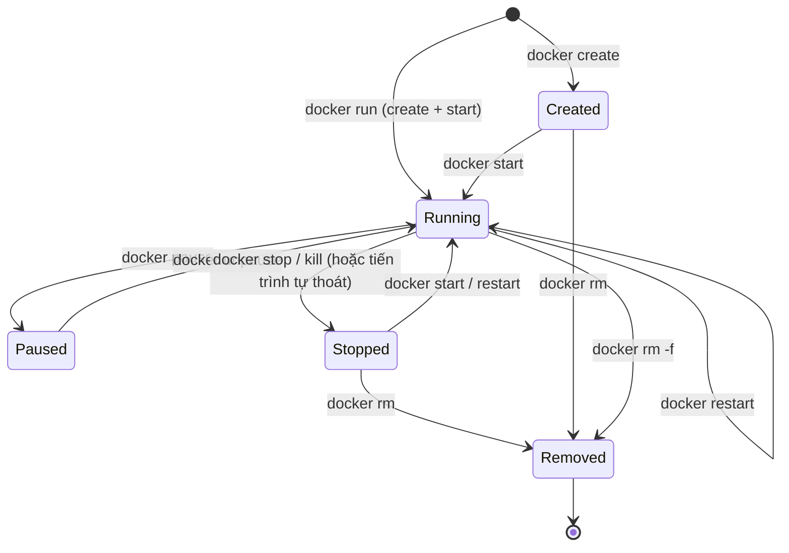

# Docker — Tổng hợp câu lệnh thường dùng

> Mỗi lệnh gồm: **mô tả ngắn**, **cú pháp**, **ví dụ thực tế**. Giải thích khái niệm: xem [docker-concepts.md](docker-concepts.md).
> Ví dụ viết cho shell kiểu bash. Trên **PowerShell** thay `$(pwd)` bằng `${PWD}` hoặc `$PWD`; trên **cmd** dùng `%cd%`.
> `docker compose` (có dấu cách) là Compose v2; `docker-compose` (gạch nối) là bản cũ — cú pháp lệnh tương tự.

## Mục lục

- [Vòng đời container](#vòng-đời-container)
- [1. Image](#1-image)
- [2. Container](#2-container)
  - [`docker run` và các flag](#docker-run)
  - [Ví dụ bind mount và named volume](#ví-dụ-bind-mount-và-named-volume-với-docker-run)
  - [ps / stop / start / restart / rm](#ps--stop--start--restart--rm)
  - [exec / logs / inspect / cp](#exec--logs--inspect--cp)
- [3. Volume và Network](#3-volume-và-network)
- [4. Dọn dẹp và hệ thống](#4-dọn-dẹp-và-hệ-thống)
- [5. Docker Compose](#5-docker-compose)
- [Bảng "tình huống → lệnh"](#bảng-tình-huống--lệnh)

---

## Vòng đời container

Bản đồ nhanh: lệnh nào chuyển container sang trạng thái nào.



---

## 1. Image

| Lệnh | Tác dụng |
|---|---|
| `docker build` | Build image từ Dockerfile |
| `docker pull` | Tải image từ registry |
| `docker push` | Đẩy image lên registry |
| `docker images` | Liệt kê image trong máy |
| `docker tag` | Gắn thêm tên/tag cho image |
| `docker rmi` / `docker image rm` | Xoá image |
| `docker inspect` | Xem chi tiết (JSON) |
| `docker history` | Xem các layer của image |

### `docker build`
Build image từ Dockerfile + build context.

```bash
docker build [OPTIONS] PATH|URL|-
```

| Flag | Ý nghĩa |
|---|---|
| `-t name:tag` | Đặt tên và tag cho image (có thể lặp nhiều lần) |
| `-f file` | Chỉ định Dockerfile (mặc định `./Dockerfile`) |
| `--no-cache` | Bỏ qua build cache |
| `--build-arg K=V` | Truyền giá trị cho `ARG` |
| `--target stage` | Dừng ở một stage của multi-stage build |
| `--platform linux/amd64` | Build cho kiến trúc CPU cụ thể |

```bash
docker build -t myapp:1.0 .                          # build từ thư mục hiện tại
docker build -t myapp:dev -f Dockerfile.dev .         # dùng Dockerfile khác
docker build --no-cache -t myapp:1.0 .                # build lại từ đầu
docker build --build-arg APP_VERSION=1.2.3 -t myapp:1.2.3 .
docker build --target build -t myapp:builder .        # chỉ build tới stage "build"
```

### `docker pull`
Tải image (hoặc cập nhật bản mới) từ registry.

```bash
docker pull [OPTIONS] NAME[:TAG|@DIGEST]
```

```bash
docker pull nginx                      # = nginx:latest từ Docker Hub
docker pull postgres:16-alpine
docker pull ghcr.io/owner/app:1.0      # registry khác Docker Hub
docker pull --platform linux/arm64 alpine
```

### `docker push`
Đẩy image lên registry (cần `docker login` và tên image có đúng `username/repo`).

```bash
docker push NAME[:TAG]
```

```bash
docker login
docker tag myapp:1.0 myuser/myapp:1.0
docker push myuser/myapp:1.0
```

### `docker images`
Liệt kê image local.

```bash
docker images [OPTIONS] [REPOSITORY[:TAG]]     # = docker image ls
```

```bash
docker images                          # tất cả image
docker images nginx                    # lọc theo repository
docker images -q                       # chỉ in ID
docker images --filter "dangling=true" # image "mồ côi" (<none>:<none>)
docker images --format "table {{.Repository}}\t{{.Tag}}\t{{.Size}}"
```

### `docker tag`
Tạo thêm tên (alias) trỏ vào cùng một image — không copy dữ liệu.

```bash
docker tag SOURCE[:TAG] TARGET[:TAG]
```

```bash
docker tag myapp:1.0 myapp:latest
docker tag myapp:1.0 registry.example.com/team/myapp:1.0
```

### `docker rmi`
Xoá image (không xoá được nếu còn container dùng, trừ khi `-f`).

```bash
docker rmi [OPTIONS] IMAGE [IMAGE...]          # = docker image rm
```

```bash
docker rmi myapp:1.0
docker rmi -f 3f1e2d4c5b6a                     # ép xoá theo ID
docker rmi $(docker images -q --filter "dangling=true")   # xoá image mồ côi
```

### `docker inspect` (image)
Xem metadata chi tiết: layers, env, cmd, entrypoint, port...

```bash
docker inspect [OPTIONS] IMAGE
```

```bash
docker inspect nginx
docker inspect --format '{{.Config.ExposedPorts}}' nginx
docker inspect --format '{{.Config.Cmd}} {{.Config.Entrypoint}}' nginx
```

### `docker history`
Xem từng layer: chỉ thị tạo ra nó và kích thước — hữu ích để tìm layer làm image phình to.

```bash
docker history [OPTIONS] IMAGE
```

```bash
docker history myapp:1.0
docker history --no-trunc myapp:1.0            # hiện đầy đủ chỉ thị
```

---

## 2. Container

| Lệnh | Tác dụng |
|---|---|
| `docker run` | Tạo và chạy container mới từ image |
| `docker ps` | Liệt kê container |
| `docker stop` | Dừng êm (SIGTERM → SIGKILL) |
| `docker start` | Chạy lại container đã dừng |
| `docker restart` | Dừng rồi chạy lại |
| `docker rm` | Xoá container |
| `docker exec` | Chạy lệnh trong container đang chạy |
| `docker logs` | Xem log (stdout/stderr) |
| `docker inspect` | Xem chi tiết (JSON) |
| `docker cp` | Copy file giữa host và container |

### `docker run`
Tạo container mới từ image và chạy nó (= `docker create` + `docker start`). Nếu image chưa có sẽ tự `pull`.

```bash
docker run [OPTIONS] IMAGE [COMMAND] [ARG...]
```

| Flag | Ý nghĩa | Ví dụ |
|---|---|---|
| `-d` | Chạy nền (detached), in container ID | `docker run -d nginx` |
| `-it` | `-i` giữ stdin + `-t` cấp terminal → dùng để tương tác (shell) | `docker run -it ubuntu bash` |
| `-p host:container` | Publish port ra host | `-p 8080:80`, `-p 127.0.0.1:5432:5432` |
| `-v` | Mount volume / bind mount | `-v pgdata:/data`, `-v "$(pwd)":/app` |
| `-e KEY=VAL` | Đặt biến môi trường | `-e POSTGRES_PASSWORD=secret` |
| `--env-file f` | Nạp biến từ file | `--env-file .env` |
| `--name` | Đặt tên container (thay tên ngẫu nhiên) | `--name web` |
| `--rm` | Tự xoá container khi nó thoát | `docker run --rm alpine echo hi` |
| `--network` | Gắn vào network | `--network mynet` |
| `--restart` | Chính sách tự khởi động lại: `no` (mặc định), `on-failure[:n]`, `always`, `unless-stopped` | `--restart unless-stopped` |
| `--memory` / `-m` | Giới hạn RAM | `--memory 512m` |
| `--cpus` | Giới hạn số CPU | `--cpus 1.5` |
| `-w dir` | Đặt working directory | `-w /app` |
| `-u user` | Chạy dưới user khác | `-u 1000:1000` |
| `--entrypoint` | Ghi đè ENTRYPOINT | `--entrypoint sh` |

```bash
# Web server chạy nền, map port, đặt tên
docker run -d --name web -p 8080:80 nginx

# Shell tương tác, tự dọn khi thoát
docker run -it --rm ubuntu bash

# Chạy một lệnh một lần rồi thoát
docker run --rm alpine echo "hello"

# Database với biến môi trường + tự khởi động lại
docker run -d --name db \
  -e POSTGRES_USER=app -e POSTGRES_PASSWORD=secret -e POSTGRES_DB=appdb \
  --restart unless-stopped \
  postgres:16-alpine

# Giới hạn tài nguyên
docker run -d --name worker --memory 512m --cpus 1.5 myapp:1.0

# Gắn vào network tự tạo để gọi nhau bằng tên
docker network create mynet
docker run -d --name db  --network mynet postgres:16-alpine
docker run -d --name web --network mynet -p 8080:3000 -e DB_HOST=db myapp:1.0
```

#### Ví dụ bind mount và named volume với `docker run`

**Named volume** — Docker quản lý, dùng cho dữ liệu cần bền (database):

```bash
# Tạo container DB gắn volume "pgdata" (tự tạo nếu chưa có)
docker run -d --name db \
  -e POSTGRES_PASSWORD=secret \
  -v pgdata:/var/lib/postgresql/data \
  postgres:16-alpine

# Xoá container → dữ liệu vẫn còn trong volume
docker rm -f db
# Tạo container mới gắn lại volume → dữ liệu cũ vẫn ở đó
docker run -d --name db2 -e POSTGRES_PASSWORD=secret -v pgdata:/var/lib/postgresql/data postgres:16-alpine
```

**Bind mount** — gắn thư mục trên host, dùng cho dev (sửa code → container thấy ngay):

```bash
# Linux / macOS / Git Bash
docker run -d --name web -p 3000:3000 \
  -v "$(pwd)":/app \
  -w /app \
  node:20-alpine npm run dev

# PowerShell (Windows)
docker run -d --name web -p 3000:3000 `
  -v "${PWD}:/app" `
  -w /app `
  node:20-alpine npm run dev

# Mount chỉ-đọc (:ro) — container không sửa được file trên host
docker run -d --name nginx -p 8080:80 \
  -v "$(pwd)/site":/usr/share/nginx/html:ro \
  nginx

# Mount một file cấu hình
docker run -d --name nginx -p 8080:80 \
  -v "$(pwd)/nginx.conf":/etc/nginx/nginx.conf:ro \
  nginx
```

**Kết hợp cả hai** (bind mount code + named volume cho `node_modules` để không bị host ghi đè):

```bash
docker run -d --name web -p 3000:3000 \
  -v "$(pwd)":/app \
  -v node_modules:/app/node_modules \
  node:20-alpine npm run dev
```

> Cú pháp `--mount` tường minh hơn `-v`: `--mount type=volume,src=pgdata,dst=/data` và `--mount type=bind,src="$(pwd)",dst=/app,readonly`.
> Bind mount với đường dẫn không tồn tại: `-v` tự tạo thư mục rỗng, `--mount` báo lỗi.

### `ps` / `stop` / `start` / `restart` / `rm`

#### `docker ps`
Liệt kê container (mặc định chỉ container đang chạy).

```bash
docker ps [OPTIONS]                  # = docker container ls
```

```bash
docker ps                            # đang chạy
docker ps -a                         # tất cả, kể cả đã dừng
docker ps -q                         # chỉ ID
docker ps -a --filter "status=exited"
docker ps --filter "name=web"
docker ps --format "table {{.Names}}\t{{.Status}}\t{{.Ports}}"
```

#### `docker stop`
Gửi `SIGTERM`, đợi (mặc định 10s) rồi gửi `SIGKILL` nếu chưa thoát.

```bash
docker stop [OPTIONS] CONTAINER [CONTAINER...]
```

```bash
docker stop web
docker stop -t 30 db                 # cho tối đa 30s để tắt êm
docker stop $(docker ps -q)          # dừng tất cả container đang chạy
```

#### `docker start`
Chạy lại container đã dừng (giữ nguyên cấu hình & lớp ghi cũ).

```bash
docker start [OPTIONS] CONTAINER [CONTAINER...]
```

```bash
docker start web
docker start -a web                  # attach xem output
```

#### `docker restart`
Dừng rồi chạy lại.

```bash
docker restart [OPTIONS] CONTAINER [CONTAINER...]
```

```bash
docker restart web
docker restart -t 5 web
```

#### `docker rm`
Xoá container (phải dừng trước, hoặc dùng `-f`).

```bash
docker rm [OPTIONS] CONTAINER [CONTAINER...]
```

```bash
docker rm web
docker rm -f web                     # ép xoá cả khi đang chạy
docker rm -v web                     # xoá luôn anonymous volume đi kèm
docker rm $(docker ps -aq)           # xoá TẤT CẢ container (cẩn thận!)
docker rm $(docker ps -aq --filter "status=exited")   # chỉ container đã thoát
```

### `exec` / `logs` / `inspect` / `cp`

#### `docker exec`
Chạy lệnh **trong container đang chạy** (không tạo container mới).

```bash
docker exec [OPTIONS] CONTAINER COMMAND [ARG...]
```

```bash
docker exec -it web sh                          # mở shell (Alpine thường chỉ có sh)
docker exec -it db bash
docker exec db psql -U app -d appdb -c "SELECT 1;"
docker exec -u root -it web sh                  # vào với quyền root
docker exec -w /app web ls -la                  # chạy ở thư mục chỉ định
docker exec -e DEBUG=1 web node script.js
```

#### `docker logs`
Xem output (stdout/stderr) của tiến trình chính.

```bash
docker logs [OPTIONS] CONTAINER
```

| Flag | Ý nghĩa |
|---|---|
| `-f` | Theo dõi realtime (follow) |
| `--tail N` | Chỉ N dòng cuối |
| `--since 10m` | Từ 10 phút trước (hoặc timestamp) |
| `-t` | Kèm timestamp |

```bash
docker logs web
docker logs -f web                    # Ctrl+C để thoát, container vẫn chạy
docker logs --tail 100 web
docker logs --since 30m -t web
docker logs -f --tail 50 web
```

#### `docker inspect` (container)
Thông tin chi tiết dạng JSON: IP, mount, env, trạng thái, port...

```bash
docker inspect [OPTIONS] CONTAINER
```

```bash
docker inspect web
docker inspect --format '{{.NetworkSettings.IPAddress}}' web          # IP (default bridge)
docker inspect --format '{{json .Mounts}}' db                         # các mount
docker inspect --format '{{.State.Status}} {{.State.ExitCode}}' web   # trạng thái + exit code
docker port web                                                       # xem port mapping
```

#### `docker cp`
Copy file/thư mục giữa host và container (chạy được cả khi container đã dừng).

```bash
docker cp [OPTIONS] CONTAINER:SRC_PATH DEST_PATH     # container → host
docker cp [OPTIONS] SRC_PATH CONTAINER:DEST_PATH     # host → container
```

```bash
docker cp web:/etc/nginx/nginx.conf ./nginx.conf     # lấy file ra
docker cp ./index.html web:/usr/share/nginx/html/    # đưa file vào
docker cp db:/var/lib/postgresql/data ./backup       # copy cả thư mục
```

---

## 3. Volume và Network

### Volume

| Lệnh | Tác dụng |
|---|---|
| `docker volume create` | Tạo volume |
| `docker volume ls` | Liệt kê volume |
| `docker volume inspect` | Xem chi tiết (đường dẫn thực trên host...) |
| `docker volume rm` | Xoá volume (phải không có container dùng) |
| `docker volume prune` | Xoá mọi volume không được container nào dùng |

```bash
docker volume create [OPTIONS] [VOLUME]
docker volume ls [OPTIONS]
docker volume inspect VOLUME [VOLUME...]
docker volume rm VOLUME [VOLUME...]
docker volume prune [OPTIONS]
```

```bash
docker volume create pgdata
docker volume ls
docker volume ls --filter "dangling=true"            # volume không container nào dùng
docker volume inspect pgdata                         # xem Mountpoint, Driver, Labels
docker volume rm pgdata
docker volume prune                                  # hỏi xác nhận; thêm -f để bỏ qua
```

**Sao lưu / khôi phục volume** bằng container tạm:

```bash
# Backup volume pgdata ra file tar trong thư mục hiện tại
docker run --rm -v pgdata:/data -v "$(pwd)":/backup alpine \
  tar czf /backup/pgdata.tar.gz -C /data .

# Restore vào volume (tạo mới)
docker run --rm -v pgdata_new:/data -v "$(pwd)":/backup alpine \
  tar xzf /backup/pgdata.tar.gz -C /data
```

### Network

| Lệnh | Tác dụng |
|---|---|
| `docker network create` | Tạo network |
| `docker network ls` | Liệt kê network |
| `docker network inspect` | Xem chi tiết (subnet, container đang gắn) |
| `docker network rm` | Xoá network (không còn container nào gắn) |
| `docker network connect` / `disconnect` | Gắn / gỡ container đang chạy vào network |
| `docker network prune` | Xoá network không dùng |

```bash
docker network create [OPTIONS] NETWORK
docker network ls [OPTIONS]
docker network inspect NETWORK [NETWORK...]
docker network rm NETWORK [NETWORK...]
docker network connect NETWORK CONTAINER
docker network disconnect NETWORK CONTAINER
```

```bash
docker network create mynet                                   # bridge tự tạo (có DNS theo tên)
docker network create --subnet 172.30.0.0/16 mynet2           # tự chọn dải IP
docker network ls
docker network inspect mynet                                  # xem container đang trong mạng
docker network connect mynet existing-container               # thêm container vào mạng
docker network disconnect mynet existing-container
docker network rm mynet
docker network prune
```

Ví dụ: hai container gọi nhau bằng tên:

```bash
docker network create appnet
docker run -d --name db  --network appnet -e POSTGRES_PASSWORD=secret postgres:16-alpine
docker run -it --rm --network appnet postgres:16-alpine psql -h db -U postgres   # "db" được phân giải
```

---

## 4. Dọn dẹp và hệ thống

| Lệnh | Xoá gì |
|---|---|
| `docker system df` | *(Không xoá)* Xem dung lượng đang dùng |
| `docker container prune` | Mọi container đã dừng |
| `docker image prune` | Image mồ côi (dangling); `-a` = mọi image không có container dùng |
| `docker volume prune` | Volume không container nào dùng |
| `docker network prune` | Network không dùng |
| `docker builder prune` | Build cache |
| `docker system prune` | Container dừng + network không dùng + dangling image + build cache |

> ⚠️ Các lệnh `prune` **xoá thật, không hoàn tác**. Luôn xem `docker system df` / `docker ps -a` trước. `-f` bỏ qua bước xác nhận.

### `docker system df`
Xem Docker đang chiếm bao nhiêu dung lượng (images, containers, volumes, build cache) và bao nhiêu có thể thu hồi.

```bash
docker system df [-v]
```

```bash
docker system df
docker system df -v          # chi tiết từng image/container/volume
```

### `docker system prune`
Dọn tổng hợp những thứ không dùng nữa.

```bash
docker system prune [OPTIONS]
```

| Flag | Ý nghĩa |
|---|---|
| `-a` | Xoá cả **mọi image không được container nào dùng** (không chỉ dangling) |
| `--volumes` | Xoá thêm volume không dùng ⚠️ (mất dữ liệu!) |
| `--filter "until=24h"` | Chỉ xoá thứ cũ hơn 24h |
| `-f` | Không hỏi xác nhận |

```bash
docker system prune                          # dọn an toàn cơ bản
docker system prune -a --filter "until=168h" # xoá image không dùng cũ hơn 7 ngày
docker system prune -a --volumes -f          # dọn sạch, KỂ CẢ volume (rất cẩn thận)
```

### `docker image prune`

```bash
docker image prune [OPTIONS]
```

```bash
docker image prune             # chỉ image <none> (dangling)
docker image prune -a          # mọi image không có container nào dùng
docker image prune -a --filter "until=720h"
```

### `docker container prune`

```bash
docker container prune [OPTIONS]
```

```bash
docker container prune                       # xoá mọi container đã dừng
docker container prune --filter "until=24h"
```

### Dọn lẻ bằng lệnh kết hợp

```bash
docker stop $(docker ps -q)            # dừng tất cả
docker rm $(docker ps -aq)             # xoá tất cả container
docker rmi $(docker images -q)         # xoá tất cả image
docker volume rm $(docker volume ls -q)# xoá tất cả volume
```

---

## 5. Docker Compose

Compose đọc file `compose.yaml` / `docker-compose.yml` ở thư mục hiện tại (đổi bằng `-f`). Dùng file mẫu sau cho các ví dụ — có cả **named volume** (`pgdata`) và **bind mount** (`./src`, `./nginx.conf`):

```yaml
# docker-compose.yml
services:
  web:
    build: .
    ports:
      - "8080:3000"
    environment:
      DB_HOST: db
    volumes:
      - ./src:/app/src                 # bind mount (đường dẫn host bắt đầu bằng ./ hoặc /)
      - ./nginx.conf:/etc/nginx/nginx.conf:ro
      - uploads:/app/uploads           # named volume
    depends_on:
      - db

  db:
    image: postgres:16-alpine
    environment:
      POSTGRES_PASSWORD: secret
    volumes:
      - pgdata:/var/lib/postgresql/data   # named volume

volumes:                                   # khai báo named volume ở cấp cao nhất
  pgdata:
  uploads:
```

| Lệnh | Tác dụng |
|---|---|
| `docker compose up` | Tạo + khởi động mọi service |
| `docker compose down` | Dừng + xoá container & network |
| `docker compose logs` | Xem log các service |
| `docker compose ps` | Liệt kê container của project |
| `docker compose exec` | Chạy lệnh trong service đang chạy |
| `docker compose build` | Build image cho các service có `build:` |
| `docker compose restart` | Khởi động lại service |

### `docker compose up`
Tạo network/volume, build/pull image nếu cần, tạo và chạy các service.

```bash
docker compose up [OPTIONS] [SERVICE...]
```

| Flag | Ý nghĩa |
|---|---|
| `-d` | Chạy nền |
| `--build` | Build lại image trước khi chạy |
| `--force-recreate` | Tạo lại container dù cấu hình không đổi |
| `--no-deps` | Không khởi động service phụ thuộc |
| `--scale svc=N` | Chạy N bản của service |
| `--wait` | Chờ service healthy |

```bash
docker compose up                       # chạy foreground, thấy log (Ctrl+C để dừng)
docker compose up -d                    # chạy nền
docker compose up -d --build            # build lại rồi chạy (sau khi sửa Dockerfile/code được COPY)
docker compose up -d db                 # chỉ chạy service db
docker compose up -d --scale web=3      # 3 replica (bỏ ports cố định để tránh trùng port)
docker compose -f compose.prod.yaml up -d
```

### `docker compose down`
Dừng và **xoá container + network** của project. Volume được giữ lại trừ khi thêm `-v`.

```bash
docker compose down [OPTIONS]
```

```bash
docker compose down                     # giữ nguyên named volume (dữ liệu DB còn)
docker compose down -v                  # xoá luôn named volume ⚠️ mất dữ liệu
docker compose down --rmi local         # xoá luôn image do compose build
docker compose down --remove-orphans    # xoá container của service đã bị bỏ khỏi file
```

### `docker compose logs`

```bash
docker compose logs [OPTIONS] [SERVICE...]
```

```bash
docker compose logs                     # log mọi service
docker compose logs -f web              # theo dõi realtime service web
docker compose logs --tail 100 db
docker compose logs -f -t web db        # kèm timestamp, nhiều service
```

### `docker compose ps`

```bash
docker compose ps [OPTIONS] [SERVICE...]
```

```bash
docker compose ps                       # container đang chạy của project
docker compose ps -a                    # gồm cả đã dừng
docker compose ps --services            # chỉ tên service
```

### `docker compose exec`
Chạy lệnh trong container service **đang chạy** (dùng tên *service*, không phải tên container).

```bash
docker compose exec [OPTIONS] SERVICE COMMAND [ARG...]
```

```bash
docker compose exec web sh
docker compose exec db psql -U postgres
docker compose exec -u root web sh
docker compose exec -T db pg_dump -U postgres appdb > backup.sql   # -T: tắt TTY khi pipe/redirect
```

Để chạy lệnh trong **container mới, dùng một lần** (không cần service đang chạy): `docker compose run --rm web npm test`.

### `docker compose build`

```bash
docker compose build [OPTIONS] [SERVICE...]
```

```bash
docker compose build                    # build mọi service có "build:"
docker compose build web
docker compose build --no-cache web
docker compose build --build-arg APP_VERSION=1.2 web
```

### `docker compose restart`
Khởi động lại container (không đọc lại file compose, không recreate).

```bash
docker compose restart [OPTIONS] [SERVICE...]
```

```bash
docker compose restart                  # tất cả
docker compose restart web
docker compose restart -t 5 web
```

> Đổi `environment`/`ports`/`volumes` trong file → dùng `docker compose up -d` (Compose tự recreate service thay đổi), không phải `restart`.

### Lệnh Compose hữu ích khác

```bash
docker compose stop [SERVICE]           # dừng nhưng KHÔNG xoá container
docker compose start [SERVICE]          # chạy lại container đã stop
docker compose pull                     # pull image mới cho các service
docker compose config                   # in compose đã gộp & thay biến (kiểm tra cú pháp, .env)
docker compose images                   # image mà các service dùng
docker compose top                      # tiến trình trong các service
docker compose cp web:/app/log.txt .    # copy file
docker compose run --rm web npm test    # chạy lệnh một lần trong container mới
```

### Ví dụ trọn vẹn: workflow phát triển

```bash
docker compose up -d --build            # khởi động stack (build image web)
docker compose ps                       # kiểm tra
docker compose logs -f web              # xem log web
docker compose exec db psql -U postgres # vào DB
docker compose down                     # tắt stack, GIỮ dữ liệu (pgdata)
docker compose down -v                  # tắt và XOÁ dữ liệu (reset sạch)
```

Kiểm tra dữ liệu named volume còn sống sau `down`:

```bash
docker compose up -d
docker compose exec db psql -U postgres -c "CREATE TABLE t(id int);"
docker compose down                     # xoá container, giữ volume
docker compose up -d
docker compose exec db psql -U postgres -c "\dt"      # bảng "t" vẫn còn
docker volume ls                        # thấy <project>_pgdata
```

---

## Bảng "tình huống → lệnh"

| Tôi muốn... | Lệnh |
|---|---|
| Chạy nhanh một web server thử | `docker run -d -p 8080:80 --name web nginx` |
| Vào shell của container đang chạy | `docker exec -it web sh` |
| Thử một lệnh trong môi trường sạch rồi bỏ | `docker run --rm -it ubuntu bash` |
| Xem log đang chạy | `docker logs -f --tail 100 web` |
| Biết container dùng IP/mount nào | `docker inspect web` |
| Lấy file từ container ra host | `docker cp web:/path/file ./file` |
| Build và gắn tag image | `docker build -t myapp:1.0 .` |
| Đẩy image lên Docker Hub | `docker tag myapp:1.0 user/myapp:1.0 && docker push user/myapp:1.0` |
| Biết Docker đang tốn bao nhiêu ổ đĩa | `docker system df` |
| Dọn container/image/network không dùng | `docker system prune` |
| Khởi động cả stack nhiều service | `docker compose up -d` |
| Tắt stack nhưng giữ dữ liệu | `docker compose down` |
| Reset sạch cả dữ liệu | `docker compose down -v` |
| Áp dụng thay đổi file compose | `docker compose up -d` |
| Áp dụng thay đổi code đã `COPY` vào image | `docker compose up -d --build` |
