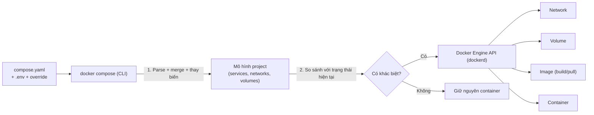
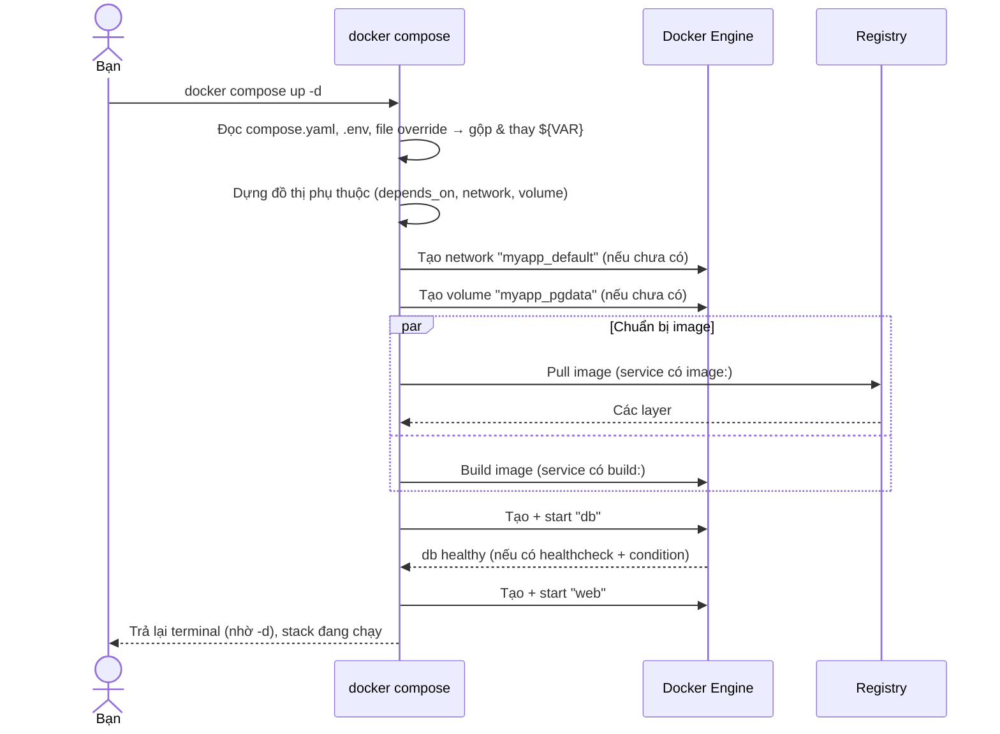
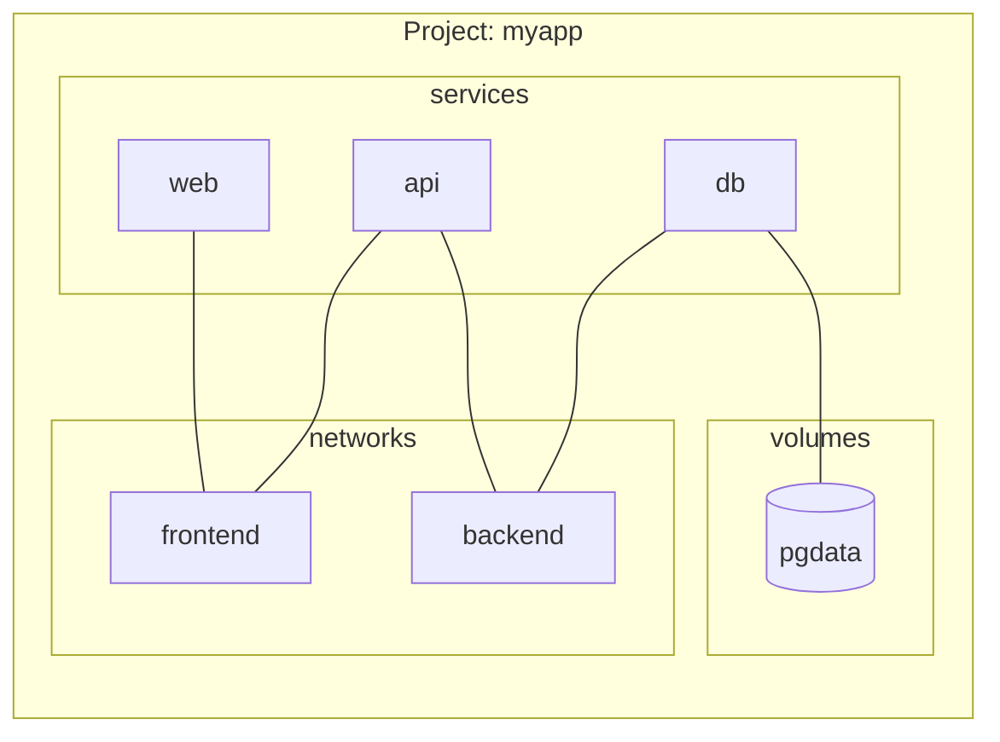
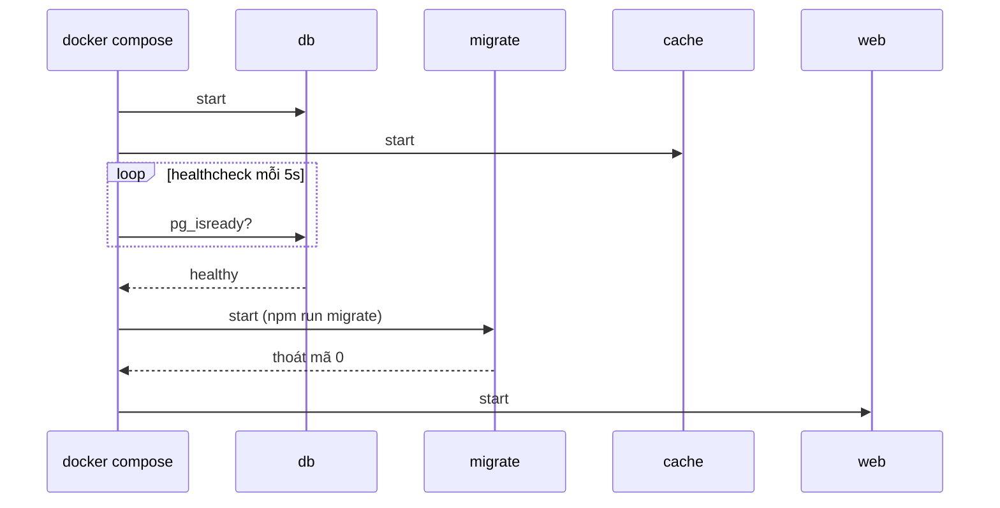
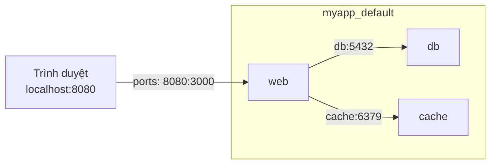
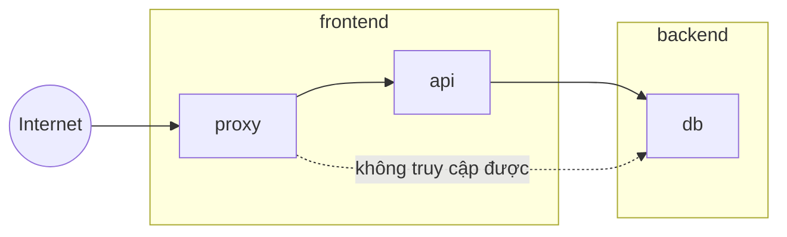
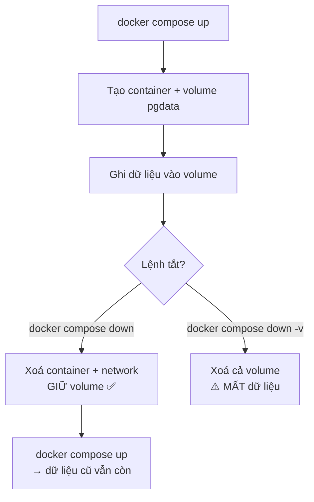
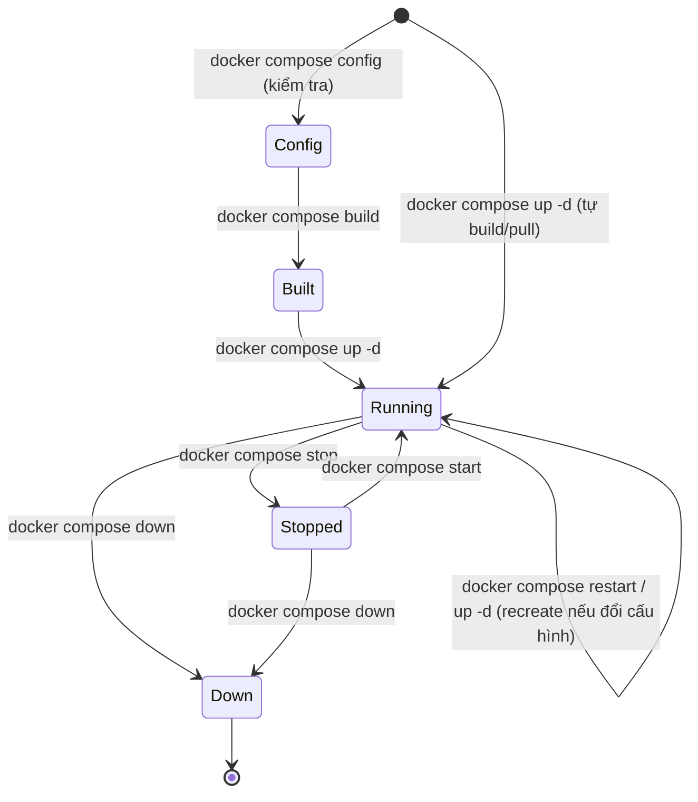

# Docker Compose — Cách hoạt động & lệnh thường dùng

> Tài liệu chuyên sâu về Docker Compose. Khái niệm nền (image, network, volume...) xem [docker-concepts.md](docker-concepts.md); danh sách lệnh Docker nói chung xem [docker-commands.md](docker-commands.md).
> Sơ đồ dùng Mermaid. Lệnh chuẩn là `docker compose` (Compose v2, plugin của Docker CLI). `docker-compose` (gạch nối) là bản v1 cũ đã ngừng hỗ trợ.

## Mục lục

1. [Compose là gì và giải quyết vấn đề gì](#1-compose-là-gì-và-giải-quyết-vấn-đề-gì)
2. [Compose hoạt động ra sao bên dưới](#2-compose-hoạt-động-ra-sao-bên-dưới)
3. [Cấu trúc file Compose](#3-cấu-trúc-file-compose)
4. [Chi tiết các khóa quan trọng của service](#4-chi-tiết-các-khóa-quan-trọng-của-service)
5. [Khởi động có thứ tự: `depends_on` và `healthcheck`](#5-khởi-động-có-thứ-tự-depends_on-và-healthcheck)
6. [Network trong Compose](#6-network-trong-compose)
7. [Volume trong Compose](#7-volume-trong-compose)
8. [Biến môi trường, `.env` và interpolation](#8-biến-môi-trường-env-và-interpolation)
9. [Nhiều môi trường: override, profiles, extends](#9-nhiều-môi-trường-override-profiles-extends)
10. [Vòng đời project & các lệnh phổ biến](#10-vòng-đời-project--các-lệnh-phổ-biến)
11. [Ví dụ hoàn chỉnh](#11-ví-dụ-hoàn-chỉnh)
12. [Mẹo, best practice và lỗi thường gặp](#12-mẹo-best-practice-và-lỗi-thường-gặp)

---

## 1. Compose là gì và giải quyết vấn đề gì

Một ứng dụng thực tế thường gồm nhiều thành phần: web, API, database, cache, worker... Nếu chạy bằng `docker run` thủ công bạn phải:

- gõ nhiều lệnh dài với hàng loạt flag (`-p`, `-v`, `-e`, `--network`, `--restart`...),
- tự tạo network/volume trước, tự nhớ thứ tự khởi động,
- khó chia sẻ cấu hình cho đồng đội, khó tái lập.

**Docker Compose** cho phép mô tả **toàn bộ stack bằng một file YAML** (kiểu *declarative*: bạn khai báo trạng thái mong muốn, Compose tự tìm cách đạt tới nó) rồi quản lý nó bằng vài lệnh.

| `docker run` thủ công | Docker Compose |
|---|---|
| Nhiều lệnh, nhiều flag | Một file YAML, version được trong git |
| Tự tạo network, volume | Tự tạo và dọn theo project |
| Gọi nhau bằng IP hoặc tự nối network | Tự có network chung, gọi nhau bằng **tên service** |
| Khởi động/tắt từng container | `up` / `down` cả stack |

Compose phù hợp nhất cho **một máy** (dev, test, CI, server nhỏ). Chạy cluster nhiều máy là bài toán của Swarm/Kubernetes.

---

## 2. Compose hoạt động ra sao bên dưới

Compose **không phải một daemon riêng**. Nó là một CLI (plugin `docker compose`) đóng vai trò *người điều phối*: đọc file YAML rồi **gọi Docker Engine API** (cùng daemon mà lệnh `docker` dùng) để tạo network, volume, build image và tạo/chạy container.



### Nhận diện tài nguyên thuộc project: **project name** và **label**

- **Project name** mặc định = tên thư mục chứa file compose (chuẩn hoá chữ thường). Đổi bằng `-p tenkhac` hoặc khóa `name:` trong file.
- Compose gắn tiền tố project vào tên tài nguyên và **gắn label** (`com.docker.compose.project`, `com.docker.compose.service`...) lên chúng. Đây là cách Compose biết container nào thuộc stack nào:
  - container: `<project>-<service>-<số thứ tự>` (vd `myapp-web-1`)
  - network: `<project>_default`
  - volume: `<project>_<tên volume>` (vd `myapp_pgdata`)

Nhờ đó hai thư mục khác nhau dùng cùng file compose sẽ tạo hai stack độc lập, không đụng nhau.

### Reconciliation — vì sao `up` chạy lại nhiều lần vẫn an toàn (idempotent)

Khi chạy `docker compose up`, Compose tính **hash cấu hình** của từng service rồi so với container hiện có:

- Cấu hình **không đổi** → giữ nguyên container, không làm gì.
- Cấu hình **đổi** (image, env, ports, volumes, command...) → **dừng và tạo lại** container đó (recreate), dùng lại named volume nên dữ liệu không mất.
- Service **mới thêm** → tạo mới.
- Service **bị xoá khỏi file** → trở thành *orphan* (container mồ côi), xoá bằng `--remove-orphans`.

### Chuỗi sự kiện khi `docker compose up -d`



### Thứ tự thực thi

Compose khởi động service theo **đồ thị phụ thuộc** từ `depends_on`: service không phụ thuộc ai chạy trước, các service phụ thuộc chạy sau; service độc lập được khởi động **song song**. `down` đảo ngược thứ tự: dừng service phụ thuộc trước.

---

## 3. Cấu trúc file Compose

Tên file được tìm theo thứ tự: `compose.yaml`, `compose.yml`, `docker-compose.yaml`, `docker-compose.yml` (ở thư mục hiện tại, rồi lên các thư mục cha). Dùng `-f` để chỉ định rõ.

Các khối ở cấp cao nhất:

| Khối | Mục đích |
|---|---|
| `name` | Tên project (tuỳ chọn, thay cho tên thư mục) |
| `services` | **Bắt buộc.** Mỗi key là một service (một loại container) |
| `networks` | Khai báo network tùy chỉnh |
| `volumes` | Khai báo named volume |
| `configs` / `secrets` | Cấp file cấu hình / secret cho service |

> Khóa `version:` ở đầu file **không còn cần** (Compose v2 bỏ qua và có thể cảnh báo "obsolete").

```yaml
name: myapp                 # (tuỳ chọn) tên project

services:
  web:
    # ... cấu hình service
  db:
    # ...

networks:
  backend:

volumes:
  pgdata:

secrets:
  db_password:
    file: ./secrets/db_password.txt
```

Mô hình quan hệ:



---

## 4. Chi tiết các khóa quan trọng của service

### Nguồn image: `image` và `build`

```yaml
services:
  db:
    image: postgres:16-alpine          # dùng image có sẵn (pull nếu chưa có)

  web:
    build: .                           # build từ Dockerfile ở thư mục hiện tại
    image: myuser/web:1.0              # (tuỳ chọn) đặt tên cho image sau khi build

  api:
    build:
      context: ./api                   # build context
      dockerfile: Dockerfile.dev       # Dockerfile khác tên mặc định
      target: runtime                  # stage của multi-stage
      args:                            # truyền cho ARG
        APP_VERSION: "1.2.3"
```

| Khóa | Ý nghĩa |
|---|---|
| `image` | Image để chạy (hoặc tên đặt cho image khi có `build`) |
| `build` | Cấu hình build (`context`, `dockerfile`, `args`, `target`, `cache_from`...) |
| `pull_policy` | `always` / `missing` / `never` / `build` — khi nào pull |

### Lệnh chạy: `command`, `entrypoint`, `working_dir`, `user`

```yaml
    command: ["npm", "run", "dev"]     # ghi đè CMD của image
    entrypoint: ["/entrypoint.sh"]     # ghi đè ENTRYPOINT
    working_dir: /app
    user: "1000:1000"
    init: true                         # dùng init process để dọn zombie, chuyển tiếp tín hiệu
```

### Port: `ports` và `expose`

```yaml
    ports:
      - "8080:3000"                    # host:container (luôn đặt trong nháy kép)
      - "127.0.0.1:5432:5432"          # chỉ truy cập từ máy host
      - target: 80                     # dạng dài
        published: "8081"
        protocol: tcp
    expose:
      - "3000"                         # chỉ khai báo cho các service khác trong network, KHÔNG mở ra host
```

> **Luôn bọc `"host:container"` trong nháy**: YAML có thể diễn giải `22:22` thành số hệ 60 (sexagesimal).
> `ports` mở ra host. Các service trong cùng network gọi nhau trực tiếp bằng port *bên trong* container, không cần `ports` hay `expose`.

### Môi trường: `environment`, `env_file`

```yaml
    environment:
      NODE_ENV: development            # dạng map
      DB_HOST: db
      API_KEY:                         # không có giá trị → lấy từ shell/.env
    # hoặc dạng list:
    # environment:
    #   - NODE_ENV=development
    env_file:
      - .env.web                       # nạp cả file vào container
```

### Lưu trữ: `volumes`

```yaml
    volumes:
      - ./src:/app/src                 # bind mount (đường dẫn host: bắt đầu bằng ./ hoặc /)
      - pgdata:/var/lib/postgresql/data  # named volume (phải khai báo ở khối volumes cấp cao)
      - ./nginx.conf:/etc/nginx/nginx.conf:ro   # :ro = chỉ đọc
      - type: tmpfs                    # dạng dài
        target: /tmp
```

### Vận hành: `restart`, `healthcheck`, `deploy.resources`

```yaml
    restart: unless-stopped            # no | always | on-failure[:n] | unless-stopped
    healthcheck:
      test: ["CMD", "curl", "-f", "http://localhost:3000/health"]
      interval: 10s                    # chu kỳ kiểm tra
      timeout: 3s                      # quá thời gian này = thất bại
      retries: 5                       # thất bại liên tiếp bao nhiêu lần thì "unhealthy"
      start_period: 20s                # thời gian "ân hạn" lúc mới khởi động
    deploy:
      resources:
        limits:
          cpus: "1.0"
          memory: 512M
```

### Bảng tóm tắt khóa hay dùng

| Khóa | Mục đích | Tương đương `docker run` |
|---|---|---|
| `container_name` | Đặt tên container cố định (**hạn chế dùng**: chặn scale) | `--name` |
| `ports` | Publish port | `-p` |
| `volumes` | Mount volume/bind | `-v` |
| `environment` / `env_file` | Biến môi trường | `-e` / `--env-file` |
| `networks` | Gắn vào network | `--network` |
| `restart` | Chính sách khởi động lại | `--restart` |
| `command` / `entrypoint` | Lệnh chạy | `COMMAND` / `--entrypoint` |
| `working_dir` | Thư mục làm việc | `-w` |
| `user` | User chạy tiến trình | `-u` |
| `deploy.resources.limits` | Giới hạn CPU/RAM | `--cpus` / `--memory` |
| `stdin_open` + `tty` | Giữ stdin + cấp terminal | `-it` |
| `extra_hosts` | Thêm dòng vào `/etc/hosts` | `--add-host` |
| `labels` | Gắn nhãn | `--label` |
| `profiles` | Chỉ chạy khi bật profile | — |

---

## 5. Khởi động có thứ tự: `depends_on` và `healthcheck`

`depends_on` quyết định **thứ tự khởi động**. Mặc định chỉ đợi container kia **được start**, *không* đợi ứng dụng trong đó **sẵn sàng** (ví dụ Postgres cần vài giây khởi tạo mới nhận kết nối). Có 3 điều kiện:

| `condition` | Đợi đến khi |
|---|---|
| `service_started` (mặc định) | Container đã được start |
| `service_healthy` | Healthcheck của service đó báo **healthy** |
| `service_completed_successfully` | Service đó chạy xong và thoát với mã 0 (dùng cho job migrate/init) |

```yaml
services:
  web:
    build: .
    depends_on:
      db:
        condition: service_healthy
      migrate:
        condition: service_completed_successfully
      cache:
        condition: service_started

  migrate:                              # job chạy một lần
    build: .
    command: ["npm", "run", "migrate"]
    depends_on:
      db:
        condition: service_healthy
    restart: "no"

  db:
    image: postgres:16-alpine
    environment:
      POSTGRES_PASSWORD: secret
    healthcheck:
      test: ["CMD-SHELL", "pg_isready -U postgres"]
      interval: 5s
      timeout: 3s
      retries: 10

  cache:
    image: redis:7-alpine
```

Trình tự kết quả:



> Dù có `condition`, ứng dụng nên **tự retry kết nối** database: DB có thể restart giữa chừng, mạng chập chờn...

---

## 6. Network trong Compose

Mặc định Compose tạo **một network bridge** tên `<project>_default` và gắn **mọi service** vào đó. Mỗi service được đăng ký DNS theo **tên service** (và alias), nên `web` kết nối `db` bằng `db:5432`.



### Tách network để cô lập

```yaml
services:
  proxy:
    image: nginx
    ports: ["80:80"]
    networks: [frontend]
  api:
    build: ./api
    networks: [frontend, backend]      # cầu nối giữa hai mạng
  db:
    image: postgres:16-alpine
    networks: [backend]                # chỉ api thấy được db, proxy thì không

networks:
  frontend:
  backend:
```



### Alias, network có sẵn bên ngoài

```yaml
services:
  api:
    networks:
      backend:
        aliases: [api.internal]        # thêm tên DNS khác

networks:
  backend:
    driver: bridge
  shared:
    external: true                     # dùng network đã tạo sẵn bằng `docker network create shared`
    name: shared
```

Lưu ý quan trọng:
- Trong container, `localhost` là **chính nó** — gọi service khác phải dùng **tên service**.
- Gọi giữa các service dùng port **trong container** (`db:5432`), không phải port đã publish ra host.
- Từ container gọi ra máy host: `host.docker.internal` (Docker Desktop; trên Linux thêm `extra_hosts: ["host.docker.internal:host-gateway"]`).

---

## 7. Volume trong Compose

Hai loại mount trong khóa `volumes:` của service, phân biệt bằng **cách viết phía nguồn**:

| Viết | Loại | Cần khai báo ở khối `volumes:` cấp cao? |
|---|---|---|
| `pgdata:/data` | Named volume | **Có** |
| `./src:/app/src` hoặc `/abs/path:/app` | Bind mount | Không |

```yaml
services:
  db:
    image: postgres:16-alpine
    volumes:
      - pgdata:/var/lib/postgresql/data      # named volume: dữ liệu DB bền

  web:
    build: .
    volumes:
      - ./src:/app/src                        # bind mount: hot reload khi dev
      - node_modules:/app/node_modules        # named volume: giữ node_modules trong container,
                                              # tránh bị thư mục host che khuất
volumes:
  pgdata:
  node_modules:
```

Vòng đời dữ liệu ứng với các lệnh:



Dùng volume đã có sẵn từ ngoài project:

```yaml
volumes:
  pgdata:
    external: true        # phải tạo trước: docker volume create pgdata
```

Dạng dài (tường minh, hỗ trợ nhiều tùy chọn):

```yaml
    volumes:
      - type: bind
        source: ./src
        target: /app/src
        read_only: true
      - type: volume
        source: pgdata
        target: /var/lib/postgresql/data
```

---

## 8. Biến môi trường, `.env` và interpolation

Có **hai cơ chế khác nhau** hay bị nhầm:

| | **Interpolation** (`.env` cạnh compose file) | **Truyền vào container** |
|---|---|---|
| Mục đích | Thay `${VAR}` **trong chính file compose** | Cấp biến cho **tiến trình trong container** |
| Cách | File `.env`, biến của shell | `environment:`, `env_file:` |
| Tự vào container? | Không | Có |

```bash
# .env  (cạnh compose.yaml, Compose tự đọc)
POSTGRES_VERSION=16
APP_PORT=8080
DB_PASSWORD=secret
```

```yaml
services:
  db:
    image: postgres:${POSTGRES_VERSION}          # interpolation
    environment:
      POSTGRES_PASSWORD: ${DB_PASSWORD}          # muốn vào container phải khai báo tường minh
  web:
    ports:
      - "${APP_PORT:-3000}:3000"                 # có giá trị mặc định
    env_file:
      - .env.web                                 # nạp trọn file vào container
```

### Cú pháp interpolation

| Cú pháp | Ý nghĩa |
|---|---|
| `${VAR}` | Giá trị của VAR (rỗng nếu chưa đặt, kèm cảnh báo) |
| `${VAR:-default}` | Dùng `default` nếu VAR **chưa đặt hoặc rỗng** |
| `${VAR-default}` | Dùng `default` nếu VAR **chưa đặt** |
| `${VAR:?lỗi}` | **Báo lỗi và dừng** nếu VAR chưa đặt/rỗng (bắt buộc phải có) |
| `$$` | Ký tự `$` nguyên văn |

### Thứ tự ưu tiên khi một biến xuất hiện ở nhiều nơi

Cho giá trị đưa **vào container** (cao → thấp):

1. `docker compose run -e VAR=...`
2. `environment:` trong compose file
3. `env_file:`
4. `ENV` trong Dockerfile

Cho **interpolation** `${VAR}`: biến của shell → file `.env` → giá trị mặc định `:-`. Chọn file env khác bằng `--env-file`:

```bash
docker compose --env-file .env.prod up -d
```

> Đừng commit `.env` chứa secret. Commit `.env.example` thay thế. Secret thực sự nên dùng khóa `secrets:`.
> `docker compose config` cho bạn thấy file **sau khi** thay biến và gộp — cách tốt nhất để debug.

---

## 9. Nhiều môi trường: override, profiles, extends

### 9.1 File override

Compose tự gộp `compose.yaml` với `compose.override.yaml` (nếu có). Quy ước: file gốc = cấu hình chung/prod; override = tiện ích cho dev (bind mount, debug port).

```yaml
# compose.yaml  (chung)
services:
  web:
    image: myuser/web:1.0
    restart: unless-stopped
```

```yaml
# compose.override.yaml  (tự gộp khi `docker compose up`, dành cho dev)
services:
  web:
    build: .
    volumes:
      - ./src:/app/src
    ports:
      - "9229:9229"           # debug port
    environment:
      NODE_ENV: development
```

Chọn nhiều file tường minh (file sau ghi đè file trước):

```bash
docker compose -f compose.yaml -f compose.prod.yaml up -d
```

Quy tắc gộp: giá trị đơn (vd `image`) bị **thay thế**; map (`environment`) được **gộp theo khóa**; list (`ports`, `volumes`) được **nối thêm**.

### 9.2 Profiles — bật/tắt service tùy ngữ cảnh

```yaml
services:
  web:
    build: .
  db:
    image: postgres:16-alpine
  adminer:                          # công cụ phụ, chỉ chạy khi cần
    image: adminer
    ports: ["8081:8080"]
    profiles: ["debug"]
  e2e:
    build: ./e2e
    profiles: ["test"]
```

```bash
docker compose up -d                           # chỉ web + db (service không có profile luôn chạy)
docker compose --profile debug up -d           # thêm adminer
docker compose --profile test run --rm e2e     # chạy riêng e2e
COMPOSE_PROFILES=debug,test docker compose up -d
```

### 9.3 Tái sử dụng cấu hình trong một file: YAML anchor và `x-` extension

```yaml
x-common: &common                    # khối "x-" bị Compose bỏ qua, chỉ để tái sử dụng
  restart: unless-stopped
  environment:
    TZ: Asia/Ho_Chi_Minh

services:
  web:
    <<: *common
    build: .
  worker:
    <<: *common
    build: .
    command: ["npm", "run", "worker"]
```

### 9.4 `include` và `extends`

- `include:` — nhúng file compose khác (thường của team/module khác) vào project hiện tại.
- `extends:` — một service kế thừa định nghĩa từ service trong file khác.

```yaml
include:
  - ./infra/compose.db.yaml
services:
  web:
    extends:
      file: common.yaml
      service: base-web
```

---

## 10. Vòng đời project & các lệnh phổ biến



### Bảng lệnh nhanh

| Nhóm | Lệnh | Tác dụng |
|---|---|---|
| Khởi động | `up` | Tạo + chạy stack (recreate service đổi cấu hình) |
| | `start` / `stop` | Chạy / dừng container đã tạo (không xoá) |
| | `restart` | Khởi động lại (không đọc lại file) |
| | `pause` / `unpause` | Tạm dừng / tiếp tục |
| Gỡ bỏ | `down` | Dừng + xoá container & network |
| | `rm` | Xoá container đã dừng của service |
| Quan sát | `ps` | Liệt kê container của project |
| | `logs` | Xem log |
| | `top` | Tiến trình đang chạy |
| | `events` | Luồng sự kiện realtime |
| Tương tác | `exec` | Chạy lệnh trong container đang chạy |
| | `run` | Chạy lệnh trong container **mới**, dùng một lần |
| | `cp` | Copy file host ↔ container |
| Image | `build` | Build image |
| | `pull` / `push` | Pull / push image của các service |
| | `images` | Liệt kê image đang dùng |
| Cấu hình | `config` | In file đã gộp + thay biến (validate) |
| | `ls` | Liệt kê mọi project Compose trên máy |

### Tuỳ chọn toàn cục (đặt trước lệnh con)

| Flag | Ý nghĩa | Ví dụ |
|---|---|---|
| `-f, --file` | Chỉ định file compose (lặp được) | `docker compose -f a.yaml -f b.yaml up` |
| `-p, --project-name` | Đặt tên project | `docker compose -p staging up -d` |
| `--env-file` | Chọn file env cho interpolation | `docker compose --env-file .env.prod up` |
| `--profile` | Bật profile | `docker compose --profile debug up` |
| `--project-directory` | Đổi thư mục gốc để phân giải đường dẫn tương đối | |

### `up` — tạo và chạy

```bash
docker compose up                          # foreground, thấy log (Ctrl+C = dừng)
docker compose up -d                       # chạy nền
docker compose up -d --build               # build lại image trước khi chạy
docker compose up -d --force-recreate      # tạo lại container dù cấu hình không đổi
docker compose up -d --no-deps web         # chỉ web, không kéo theo service phụ thuộc
docker compose up -d --scale worker=3      # chạy 3 bản worker
docker compose up -d --wait                # đợi service healthy rồi mới trả terminal (hợp CI)
docker compose up -d --remove-orphans      # dọn container của service đã bị xoá khỏi file
docker compose up --abort-on-container-exit   # dừng cả stack khi một container thoát (hợp CI/test)
docker compose up -d db cache              # chỉ chạy một số service
```

### `down` — tắt và gỡ

```bash
docker compose down                        # xoá container + network, GIỮ volume
docker compose down -v                     # xoá luôn named volume ⚠️ mất dữ liệu
docker compose down --rmi local            # xoá luôn image do compose build
docker compose down --remove-orphans
docker compose down -t 5                   # chờ tối đa 5s cho container tắt êm
```

### `stop` / `start` / `restart`

```bash
docker compose stop                        # dừng, GIỮ container (start lại được)
docker compose stop web
docker compose start                       # chạy lại container đã stop
docker compose restart                     # restart tất cả
docker compose restart -t 5 web
```

> `restart` **không đọc lại** file compose hay `.env`. Muốn áp dụng thay đổi cấu hình → `docker compose up -d`.

### `ps` / `logs` / `top`

```bash
docker compose ps                          # container đang chạy
docker compose ps -a                       # kể cả đã dừng
docker compose ps --services               # chỉ tên service
docker compose ps --format json
docker compose logs                        # log mọi service
docker compose logs -f web                 # theo dõi realtime
docker compose logs --tail 100 -t db       # 100 dòng cuối, kèm timestamp
docker compose logs --since 10m
docker compose top
```

### `exec` và `run`

```bash
docker compose exec web sh                          # shell trong service đang chạy
docker compose exec db psql -U postgres
docker compose exec -u root web sh
docker compose exec -T db pg_dump -U postgres appdb > backup.sql   # -T: tắt TTY khi redirect/pipe

docker compose run --rm web npm test                # container mới, chạy xong tự xoá
docker compose run --rm --no-deps web sh            # không khởi động service phụ thuộc
docker compose run --rm -e DEBUG=1 web node script.js
docker compose run --rm -p 3001:3000 web            # run KHÔNG tự publish ports; thêm --service-ports hoặc -p
```

| | `exec` | `run` |
|---|---|---|
| Container | Dùng container **đang chạy** | Tạo container **mới** |
| Service phải chạy sẵn? | Có | Không (tự khởi động phụ thuộc) |
| Dùng cho | Debug, vào shell, chạy lệnh nhanh | Job một lần: migrate, test, script |

### `build`, `pull`, `push`, `images`

```bash
docker compose build                       # build mọi service có "build:"
docker compose build web
docker compose build --no-cache web
docker compose build --build-arg APP_VERSION=1.2 web
docker compose pull                        # pull image mới cho các service
docker compose push                        # push image của các service lên registry
docker compose images
```

### `config`, `ls`, `cp`, `rm`, `events`

```bash
docker compose config                      # in file đã gộp + thay biến; báo lỗi cú pháp
docker compose config --services           # liệt kê tên service
docker compose config -q                   # chỉ validate, không in (hợp CI)
docker compose ls                          # mọi project Compose đang có
docker compose cp web:/app/log.txt .       # lấy file ra
docker compose cp ./config.json web:/app/
docker compose rm -f web                   # xoá container đã dừng của web
docker compose events
```

### Tình huống thường gặp → lệnh

| Tôi muốn... | Lệnh |
|---|---|
| Khởi động toàn bộ stack | `docker compose up -d` |
| Sửa code `COPY` vào image, cần build lại | `docker compose up -d --build` |
| Sửa `environment`/`ports`/`volumes` trong file | `docker compose up -d` (tự recreate) |
| Chỉ sửa code đã bind mount | Không cần làm gì (hoặc `restart` nếu app không hot-reload) |
| Xem log lỗi của một service | `docker compose logs -f --tail 100 web` |
| Vào shell debug | `docker compose exec web sh` |
| Chạy migration/test một lần | `docker compose run --rm web npm run migrate` |
| Tắt stack, giữ dữ liệu | `docker compose down` |
| Reset sạch, xoá cả DB | `docker compose down -v` |
| Biết file compose sau khi thay biến | `docker compose config` |
| Chạy bản prod | `docker compose -f compose.yaml -f compose.prod.yaml up -d` |
| Dọn container mồ côi | `docker compose up -d --remove-orphans` |

---

## 11. Ví dụ hoàn chỉnh

Stack web (Node) + Postgres + Redis, có healthcheck, migrate job, volume, network tách lớp, profile cho tool debug:

```yaml
# compose.yaml
name: shop

x-common: &common
  restart: unless-stopped
  env_file: [.env.app]

services:
  proxy:
    image: nginx:1.27-alpine
    ports:
      - "${PROXY_PORT:-80}:80"
    volumes:
      - ./nginx.conf:/etc/nginx/nginx.conf:ro     # bind mount (config)
    depends_on:
      api:
        condition: service_healthy
    networks: [frontend]

  api:
    <<: *common
    build:
      context: ./api
      args:
        APP_VERSION: ${APP_VERSION:-dev}
    environment:
      DB_HOST: db                                   # gọi bằng tên service
      DB_PASSWORD: ${DB_PASSWORD:?DB_PASSWORD is required}
      REDIS_HOST: cache
    volumes:
      - ./api/src:/app/src                          # bind mount (hot reload)
      - uploads:/app/uploads                        # named volume (file upload bền)
    healthcheck:
      test: ["CMD", "wget", "-qO-", "http://localhost:3000/health"]
      interval: 10s
      timeout: 3s
      retries: 5
      start_period: 15s
    depends_on:
      db:
        condition: service_healthy
      migrate:
        condition: service_completed_successfully
      cache:
        condition: service_started
    networks: [frontend, backend]

  migrate:
    build: ./api
    command: ["npm", "run", "migrate"]
    environment:
      DB_HOST: db
      DB_PASSWORD: ${DB_PASSWORD}
    depends_on:
      db:
        condition: service_healthy
    restart: "no"
    networks: [backend]

  db:
    image: postgres:${POSTGRES_VERSION:-16}-alpine
    environment:
      POSTGRES_USER: postgres
      POSTGRES_PASSWORD: ${DB_PASSWORD}
      POSTGRES_DB: shop
    volumes:
      - pgdata:/var/lib/postgresql/data             # named volume
    healthcheck:
      test: ["CMD-SHELL", "pg_isready -U postgres -d shop"]
      interval: 5s
      timeout: 3s
      retries: 10
    networks: [backend]                              # proxy không thấy db

  cache:
    image: redis:7-alpine
    volumes:
      - redisdata:/data
    networks: [backend]

  adminer:                                           # chỉ chạy khi: --profile debug
    image: adminer
    ports: ["127.0.0.1:8081:8080"]
    profiles: ["debug"]
    depends_on: [db]
    networks: [backend]

networks:
  frontend:
  backend:

volumes:
  pgdata:
  redisdata:
  uploads:
```

```bash
# .env  (cạnh compose.yaml)
DB_PASSWORD=change-me
POSTGRES_VERSION=16
PROXY_PORT=8080
```

Sử dụng:

```bash
docker compose config -q                    # kiểm tra file hợp lệ
docker compose up -d --build --wait         # build + chạy + đợi healthy
docker compose ps
docker compose logs -f api
docker compose --profile debug up -d adminer   # bật công cụ debug DB
docker compose exec db psql -U postgres -d shop
docker compose down                         # tắt, giữ pgdata/redisdata/uploads
docker compose down -v                      # reset sạch (xoá cả dữ liệu)
```

---

## 12. Mẹo, best practice và lỗi thường gặp

### Best practice

- **Dùng `docker compose up -d` làm lệnh mặc định** để áp dụng thay đổi; tránh `restart` khi sửa cấu hình.
- Đặt secret trong `.env`/`secrets`, **không commit**; commit `.env.example`.
- Dùng **healthcheck + `condition: service_healthy`** thay vì `sleep` hoặc script chờ.
- Dùng **named volume** cho dữ liệu cần bền (DB), **bind mount** cho code khi dev.
- Hạn chế `container_name` (chặn `--scale` và dễ đụng tên); để Compose tự đặt.
- Ghim phiên bản image (`postgres:16-alpine`) thay vì `latest` để build tái lập được.
- Cô lập bằng nhiều network; chỉ publish port cần thiết, DB nội bộ bind `127.0.0.1:` nếu phải mở.
- Thêm `.dockerignore` để build context nhỏ, không đưa `.env`, `.git`, `node_modules` vào image.
- Gọi `docker compose config` để xem kết quả sau khi gộp file/thay biến trước khi `up`.

### Lỗi thường gặp

| Triệu chứng | Nguyên nhân | Cách xử lý |
|---|---|---|
| Sửa `.env`/`environment` nhưng container vẫn giá trị cũ | Chỉ `restart` mà không recreate | `docker compose up -d` (hoặc `--force-recreate`) |
| Sửa code nhưng container chạy code cũ | Code được `COPY` vào image, không bind mount | `docker compose up -d --build` |
| `web` lỗi kết nối `db` lúc khởi động | `depends_on` mặc định không đợi sẵn sàng | Thêm `healthcheck` + `condition: service_healthy`, hoặc app tự retry |
| Kết nối `localhost:5432` từ `web` thất bại | `localhost` là chính container web | Dùng `db:5432` |
| `port is already allocated` | Port host đã có tiến trình khác dùng | Đổi port host (`"8081:80"`) hoặc tắt tiến trình đang chiếm |
| Mất dữ liệu DB sau `down` | Dùng `down -v`, hoặc không khai báo volume | Dùng named volume; chỉ dùng `-v` khi cố ý reset |
| Bind mount làm mất file có trong image (vd `node_modules`) | Thư mục host che khuất thư mục image | Thêm named volume riêng cho thư mục đó |
| `service "x" refers to undefined volume` | Dùng named volume nhưng chưa khai báo ở khối `volumes:` | Thêm vào `volumes:` cấp cao |
| `variable is not set. Defaulting to a blank string` | Dùng `${VAR}` nhưng chưa đặt | Đặt trong `.env`, hoặc dùng `${VAR:-default}` / `${VAR:?msg}` |
| `docker compose run` không truy cập được qua port | `run` không publish `ports:` của service | Thêm `--service-ports` hoặc `-p` |
| Container `Exited (0)` ngay sau `up` | Tiến trình chính thoát (không có việc chạy nền) | Kiểm tra `command`/`CMD`; xem `docker compose logs svc` |
| Port YAML như `22:22` bị hiểu sai | YAML hiểu số kiểu hệ 60 | Luôn bọc trong nháy: `"22:22"` |
| Stack cũ còn container sau khi đổi tên service | Container mồ côi | `docker compose up -d --remove-orphans` |

### Gợi ý debug theo thứ tự

```bash
docker compose config                 # 1. file sau khi gộp/thay biến có đúng ý không?
docker compose ps -a                  # 2. container nào lỗi / Exited?
docker compose logs --tail 100 svc    # 3. log nói gì?
docker compose exec svc sh            # 4. vào trong kiểm tra (env, mạng: ping db, nslookup db)
docker inspect <container>            # 5. xem mount, network, env thực tế
```
