# Docker — Khái niệm cốt lõi & cách hoạt động

> Tài liệu này giải thích **vì sao** Docker được thiết kế như vậy và **nó hoạt động ra sao** bên dưới, không chỉ liệt kê định nghĩa. Các sơ đồ dùng [Mermaid](https://mermaid.js.org/) (xem được trong VS Code với extension Markdown Preview Mermaid, GitHub, GitLab...).
> Tra cứu lệnh: xem [docker-commands.md](docker-commands.md).

## Mục lục

1. [Container và Image](#1-container-và-image)
2. [Kiến trúc Docker](#2-kiến-trúc-docker)
3. [Dockerfile](#3-dockerfile)
4. [Docker Compose](#4-docker-compose)
5. [Network](#5-network)
6. [Storage: volume và bind mount](#6-storage-volume-và-bind-mount)
7. [Port mapping (`-p`) và `EXPOSE`](#7-port-mapping--p-và-expose)
8. [Biến môi trường và file `.env`](#8-biến-môi-trường-và-file-env)
9. [Phụ lục: lỗi thường gặp](#9-phụ-lục-lỗi-thường-gặp)

---

## 1. Container và Image

### Vấn đề Docker giải quyết

"Chạy được trên máy tôi" — ứng dụng phụ thuộc vào hệ điều hành, phiên bản runtime, thư viện, biến môi trường... Docker đóng gói **ứng dụng + toàn bộ môi trường chạy nó** thành một đơn vị di động, để chạy giống hệt nhau trên laptop, CI và server.

So với máy ảo (VM): container **không** có kernel riêng. Nó là một tiến trình bình thường của host được cô lập bằng các tính năng của kernel Linux (*namespaces* để cô lập những gì tiến trình "nhìn thấy": PID, network, mount...; *cgroups* để giới hạn tài nguyên CPU/RAM). Vì vậy container khởi động trong vài trăm ms và nhẹ hơn VM rất nhiều.

> Trên Windows/macOS, Docker Desktop chạy một VM Linux nhỏ (WSL2/HyperKit...) và các container chạy trong VM đó.

### Image vs Container

| | **Image** | **Container** |
|---|---|---|
| Bản chất | Bản mẫu **chỉ đọc** (read-only): filesystem + metadata (lệnh mặc định, env, port...) | Một **instance đang chạy (hoặc đã dừng)** được tạo từ image |
| Tương tự | Class / file ISO / bản cài đặt | Object / máy đang chạy |
| Thay đổi được? | Không (bất biến). Muốn đổi → build image mới | Có, nhưng chỉ ở lớp ghi tạm của chính nó |
| Số lượng | 1 image | Nhiều container từ cùng 1 image |
| Vòng đời | Tồn tại cho đến khi `docker rmi` | Tạo → chạy → dừng → xoá |

### Image layer — vì sao image gồm nhiều lớp?

Image không phải một file khối lớn mà là **chồng nhiều layer chỉ đọc**. Mỗi chỉ thị tạo thay đổi filesystem trong Dockerfile (`RUN`, `COPY`, `ADD`) sinh ra một layer mới chứa **phần khác biệt** so với layer bên dưới. Docker dùng *union filesystem* (OverlayFS) để "chồng" các layer thành một cây thư mục thống nhất.

Khi chạy container, Docker thêm **một lớp ghi (writable layer)** lên trên cùng. Mọi thao tác ghi/sửa/xoá file của container đều rơi vào lớp này (cơ chế *copy-on-write*: sửa file ở layer dưới → file được copy lên lớp ghi rồi mới sửa).

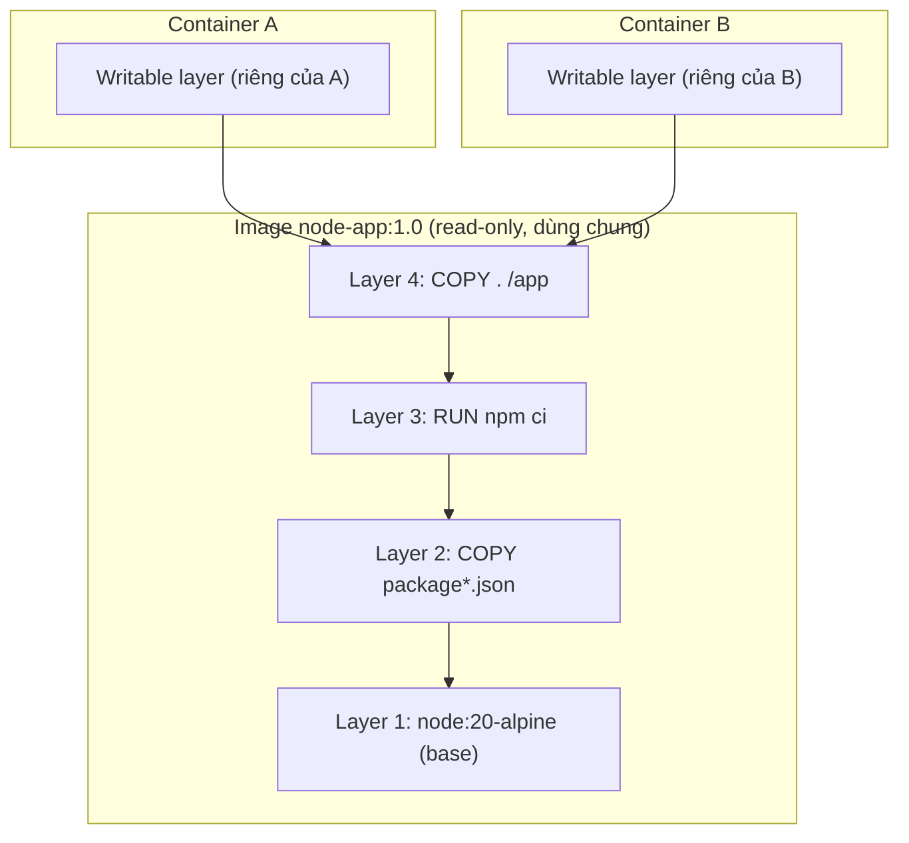

Hệ quả quan trọng:

- **Tiết kiệm dung lượng & băng thông**: hai image dùng chung base image thì layer base chỉ lưu/tải **một lần**. 10 container từ một image chỉ tốn thêm 10 lớp ghi nhỏ.
- **Container là tạm thời (ephemeral)**: xoá container → lớp ghi biến mất → dữ liệu mất. Dữ liệu cần giữ phải đặt ở volume (xem [mục 6](#6-storage-volume-và-bind-mount)).

### Build cache — vì sao thứ tự chỉ thị trong Dockerfile quan trọng?

Khi build, với mỗi chỉ thị Docker kiểm tra: *"chỉ thị này (và input của nó) giống lần trước không?"*. Nếu có → dùng lại layer đã cache, bỏ qua bước chạy. Nếu **một layer bị thay đổi, tất cả layer phía sau nó đều bị vô hiệu hoá cache**.

- `COPY`/`ADD`: so sánh **checksum nội dung** file được copy.
- `RUN`: so sánh **chuỗi lệnh** (không biết lệnh bên trong có kết quả khác hay không — ví dụ `RUN apt-get update` sẽ bị cache dù repo đã đổi).

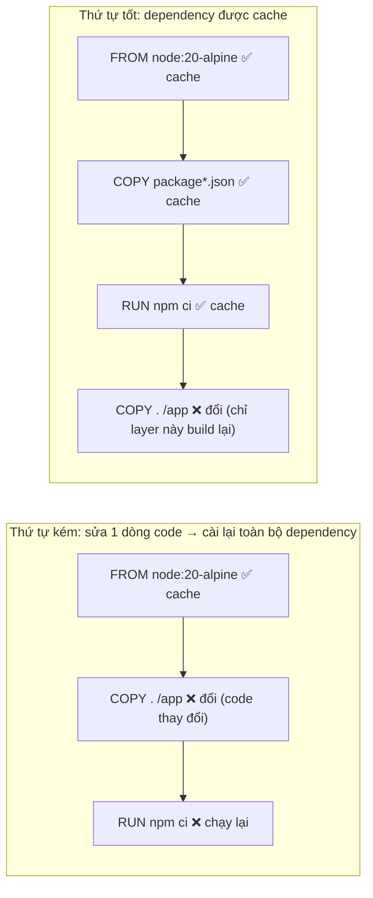

**Quy tắc vàng**: đặt thứ ít thay đổi (base image, cài dependency) **lên trên**, thứ hay thay đổi (source code) **xuống dưới**.

---

## 2. Kiến trúc Docker

Docker theo mô hình **client–server**:

| Thành phần | Vai trò |
|---|---|
| **Docker client** (`docker` CLI) | Công cụ bạn gõ lệnh. Chỉ **gửi yêu cầu** (REST API) đến daemon, không tự làm việc nặng |
| **Docker daemon** (`dockerd`) | Dịch vụ chạy nền, thật sự build image, quản lý container, network, volume. Lắng nghe qua socket (`/var/run/docker.sock`) hoặc TCP |
| **containerd + runc** | Tầng thấp bên dưới daemon: `containerd` quản lý vòng đời container/image, `runc` thực sự tạo tiến trình container (gọi namespaces/cgroups) |
| **Registry** | Kho lưu trữ & phân phối image. **Docker Hub** là registry công cộng mặc định; ngoài ra có GHCR, ECR, GCR, hoặc tự host |

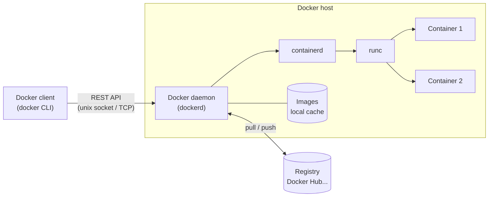

Vì client và daemon tách riêng nên client có thể điều khiển daemon **ở máy khác** (`DOCKER_HOST=ssh://user@server`) — cùng lệnh `docker`, chạy trên server từ xa.

### Điều gì xảy ra khi gõ `docker run -d -p 8080:80 nginx`?

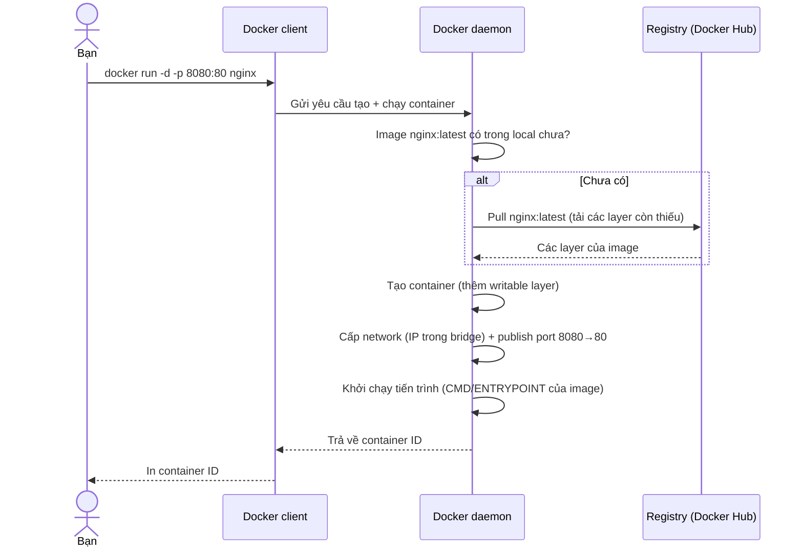

### Image được định danh thế nào?

`[registry/][namespace/]repository[:tag]` — ví dụ `docker.io/library/nginx:1.27`. Không ghi tag = `latest` (chỉ là tag mặc định, **không** đảm bảo là bản mới nhất). Image còn có **digest** (`nginx@sha256:...`) bất biến theo nội dung — dùng khi cần tái lập tuyệt đối.

---

## 3. Dockerfile

**Dockerfile** là file văn bản mô tả *công thức* build image: bắt đầu từ image nền nào, copy gì vào, chạy lệnh gì, và khi container khởi động thì chạy gì. Dockerfile giúp việc đóng gói **tái lập được, version được trong git** thay vì cấu hình tay.

### Các chỉ thị chính

| Chỉ thị | Ý nghĩa | Vì sao / ghi chú |
|---|---|---|
| `FROM` | Chọn **image nền** (layer đầu tiên). Bắt buộc, thường là chỉ thị đầu tiên | Chọn base nhỏ (`-alpine`, `-slim`) để image nhẹ. Có thể dùng nhiều `FROM` cho multi-stage |
| `RUN` | Chạy lệnh **lúc build**, kết quả lưu thành layer mới | Gộp nhiều lệnh bằng `&&` để giảm số layer & dọn rác trong cùng layer (`apt-get install ... && rm -rf /var/lib/apt/lists/*`) |
| `COPY` | Copy file từ **build context** (thư mục máy bạn) vào image | Ưu tiên hơn `ADD`. `ADD` còn tự giải nén tar và tải URL — dễ gây bất ngờ |
| `WORKDIR` | Đặt thư mục làm việc cho các chỉ thị sau (`RUN`, `COPY`, `CMD`...) và cho container lúc chạy | Tự tạo thư mục nếu chưa có; tốt hơn `RUN cd ...` (mỗi `RUN` là một shell riêng nên `cd` không giữ lại) |
| `EXPOSE` | **Khai báo** (tài liệu hoá) container lắng nghe port nào | Chỉ là metadata, **không mở port** ra ngoài. Xem [mục 7](#7-port-mapping--p-và-expose) |
| `CMD` | Lệnh/tham số **mặc định** khi container chạy | Có thể bị **ghi đè** hoàn toàn bằng `docker run image <lệnh khác>` |
| `ENTRYPOINT` | Lệnh **cố định** biến container thành "một file thực thi" | Tham số của `docker run` được **nối thêm** vào sau; muốn ghi đè phải dùng `--entrypoint` |
| `ENV` | Đặt biến môi trường, tồn tại ở **cả build lẫn runtime** | Giá trị nằm trong image (xem được bằng `docker inspect`) → **không đặt secret** |
| `ARG` | Biến chỉ tồn tại **lúc build**, truyền bằng `--build-arg` | Không có trong container đang chạy; cũng lộ trong `docker history` → không đặt secret |

### `CMD` vs `ENTRYPOINT` — hiểu bản chất

Hai chỉ thị cùng quyết định "container chạy gì khi start". Docker ghép chúng thành: **`ENTRYPOINT` + `CMD`** (CMD đóng vai trò tham số mặc định).

| Dockerfile | `docker run img` | `docker run img foo` |
|---|---|---|
| `CMD ["python","app.py"]` | `python app.py` | `foo` *(CMD bị thay thế)* |
| `ENTRYPOINT ["python"]` | `python` | `python foo` *(nối thêm)* |
| `ENTRYPOINT ["python"]`<br>`CMD ["app.py"]` | `python app.py` | `python foo` *(chỉ thay CMD)* |

**Exec form vs shell form**:

- `CMD ["node","server.js"]` — **exec form** (JSON array): chạy trực tiếp, tiến trình là PID 1, nhận tín hiệu `SIGTERM` từ `docker stop` → tắt êm. **Nên dùng.**
- `CMD node server.js` — **shell form**: chạy qua `/bin/sh -c`, PID 1 là shell, tín hiệu có thể không đến được ứng dụng → `docker stop` phải chờ 10s rồi `SIGKILL`.

### Ví dụ Dockerfile (Node.js) có chú thích

```dockerfile
# 1. Image nền
FROM node:20-alpine

# 2. Thư mục làm việc trong image
WORKDIR /app

# 3. Copy file khai báo dependency TRƯỚC để tận dụng cache
COPY package*.json ./
RUN npm ci --omit=dev

# 4. Copy source code (layer này đổi thường xuyên nên để sau)
COPY . .

# 5. Cấu hình
ARG APP_VERSION=dev          # chỉ dùng lúc build
ENV NODE_ENV=production \
    PORT=3000                # còn lại trong container lúc chạy
EXPOSE 3000

# 6. Lệnh chạy khi start container (exec form)
CMD ["node", "server.js"]
```

### Build context và `.dockerignore`

Lệnh `docker build .` gửi toàn bộ thư mục (**build context**) tới daemon. Mọi `COPY` chỉ thấy được file trong context. File `.dockerignore` (cú pháp giống `.gitignore`) loại bỏ file khỏi context → build nhanh hơn, không vô tình đưa `node_modules`, `.git`, `.env` vào image:

```
node_modules
.git
.env
*.log
```

### Multi-stage build (gợi ý nhanh)

Dùng nhiều `FROM` để build bằng image "nặng" (có compiler) rồi chỉ copy **kết quả** sang image cuối "nhẹ" → image production nhỏ và không chứa công cụ build:

```dockerfile
FROM golang:1.23 AS build
WORKDIR /src
COPY . .
RUN CGO_ENABLED=0 go build -o /out/app .

FROM gcr.io/distroless/static
COPY --from=build /out/app /app
ENTRYPOINT ["/app"]
```

### Từ Dockerfile đến image

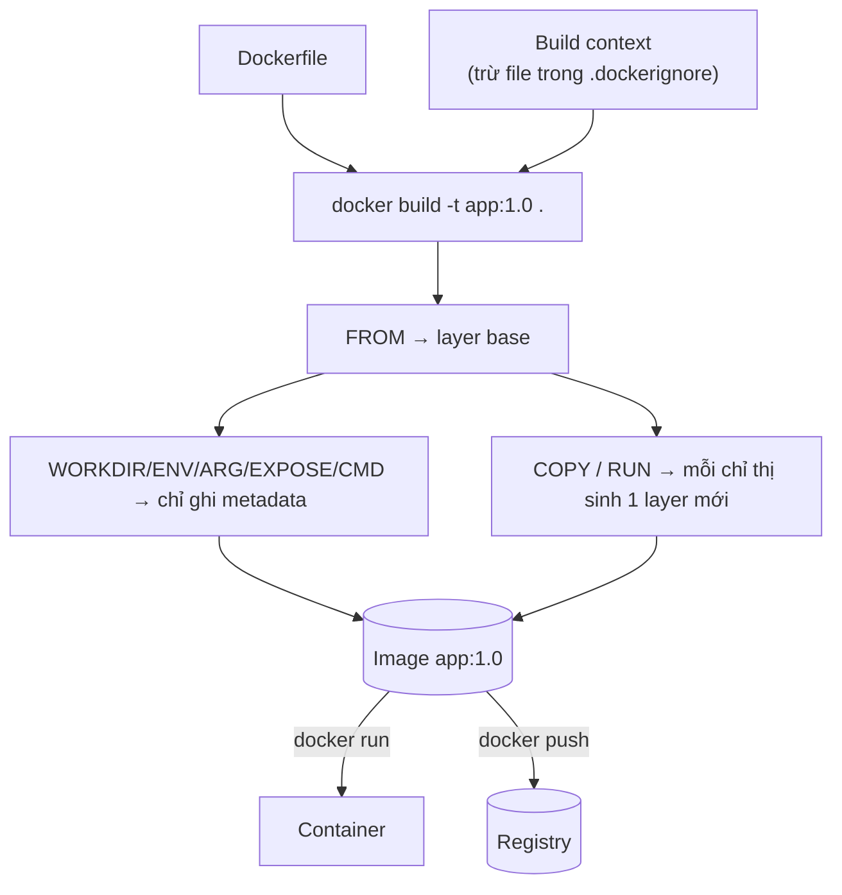

---

## 4. Docker Compose

### Vì sao cần Compose?

Một ứng dụng thật thường gồm nhiều thành phần (web, API, database, cache...). Chạy bằng `docker run` thủ công nghĩa là gõ nhiều lệnh dài với hàng đống flag (`-p`, `-v`, `-e`, `--network`...), phải nhớ thứ tự, và khó chia sẻ cho đồng đội.

**Docker Compose** cho phép **khai báo toàn bộ stack trong một file YAML** (`compose.yaml` hoặc `docker-compose.yml`) rồi điều khiển bằng một lệnh: `docker compose up`.

### Cách Compose tổ chức nhiều service

File Compose có 3 khối chính:

| Khối | Nội dung |
|---|---|
| `services` | Mỗi service = một loại container (image hoặc `build`, port, env, volume, phụ thuộc...). Có thể scale thành nhiều replica |
| `networks` | Mạng ảo cho các service (nếu không khai báo, Compose tạo sẵn **một network mặc định** cho cả project) |
| `volumes` | Khai báo **named volume** dùng chung/giữ dữ liệu |

```yaml
services:
  web:
    build: .                      # build từ Dockerfile trong thư mục hiện tại
    ports:
      - "8080:3000"               # host:container
    environment:
      DATABASE_URL: postgres://app:secret@db:5432/appdb   # gọi DB bằng TÊN SERVICE "db"
      REDIS_HOST: cache
    depends_on:
      db:
        condition: service_healthy   # chờ DB sẵn sàng thật sự
      cache:
        condition: service_started
    volumes:
      - ./src:/app/src            # bind mount: sửa code trên host, thấy ngay trong container

  db:
    image: postgres:16-alpine
    environment:
      POSTGRES_USER: app
      POSTGRES_PASSWORD: secret
      POSTGRES_DB: appdb
    volumes:
      - pgdata:/var/lib/postgresql/data   # named volume: dữ liệu DB sống sót qua `down`
    healthcheck:
      test: ["CMD-SHELL", "pg_isready -U app -d appdb"]
      interval: 5s
      timeout: 3s
      retries: 10

  cache:
    image: redis:7-alpine

volumes:
  pgdata:
```

> Compose v2 không còn cần khóa `version:` ở đầu file. Lệnh hiện đại là `docker compose` (có dấu cách); `docker-compose` (gạch nối) là bản v1 cũ.

### Compose làm gì khi `docker compose up`?

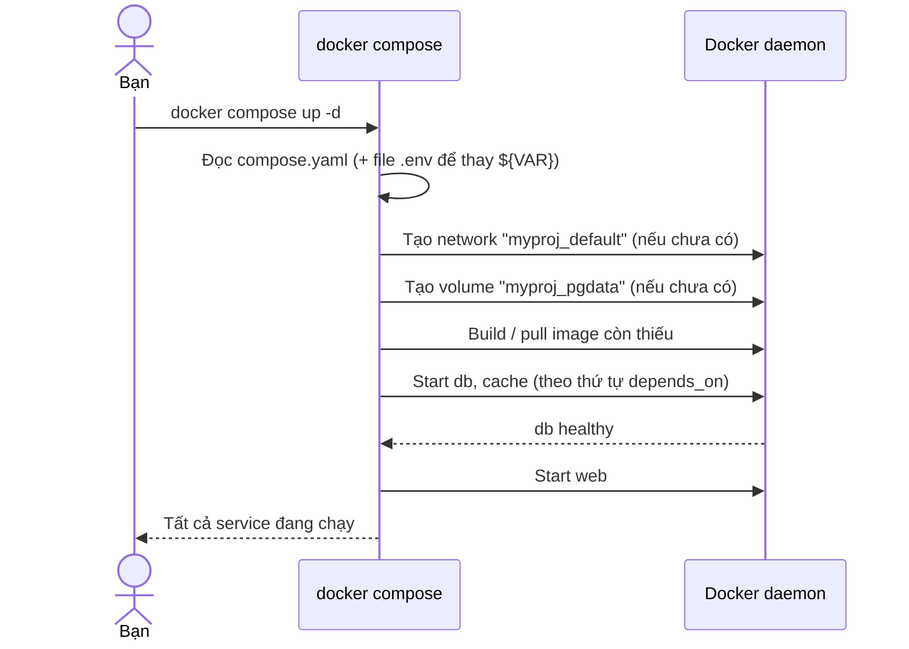

Kết quả: mọi service nằm chung một network, gọi nhau bằng tên service.

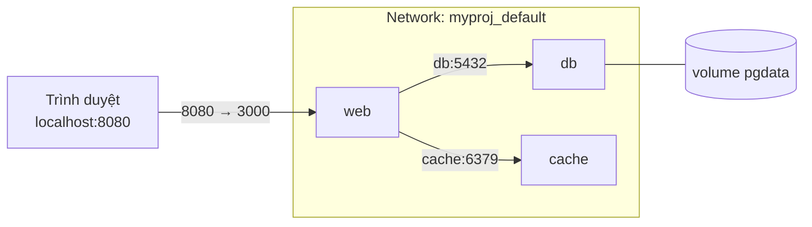

**Project name**: Compose gắn tiền tố tên project (mặc định = tên thư mục) vào network, volume, container (`myproj-web-1`) để nhiều stack không đụng nhau.

**`depends_on`** chỉ đảm bảo **thứ tự khởi động**; mặc định *không* đợi dịch vụ phía sau "sẵn sàng". Muốn đợi thật sự → kết hợp `healthcheck` + `condition: service_healthy`.

---

## 5. Network

### Vì sao cần network?

Mỗi container có network namespace riêng (card mạng, IP, bảng route riêng). Docker tạo các **network ảo** để quyết định container nào nói chuyện được với container nào và với bên ngoài.

### Các driver phổ biến

| Driver | Cách hoạt động | Khi dùng |
|---|---|---|
| **bridge** (mặc định) | Docker tạo một switch ảo trên host; mỗi container có IP riêng trong dải mạng đó; ra Internet qua NAT; từ ngoài vào phải **publish port** (`-p`) | Hầu hết trường hợp — chạy nhiều container trên một host |
| **host** | Container **dùng chung network stack của host** (không cô lập mạng, không cần `-p`) | Cần hiệu năng mạng tối đa hoặc cổng động rất nhiều. Chỉ hỗ trợ Linux đầy đủ; ít cô lập |
| **none** | Không có network (chỉ loopback) | Job xử lý offline, cô lập hoàn toàn |
| **overlay** | Mạng xuyên nhiều host (Swarm/cluster) | Orchestration nhiều máy |

### Default bridge vs user-defined bridge

| | Network `bridge` mặc định | Network tự tạo (`docker network create`) / Compose |
|---|---|---|
| Gọi nhau bằng **tên** | ❌ Chỉ bằng IP (hay đổi) | ✅ DNS nội bộ tự phân giải tên container/service |
| Cô lập | Mọi container không chỉ định network đều dùng chung | Chỉ những container được gắn vào mới thấy nhau |
| Gắn/gỡ khi đang chạy | Hạn chế | `docker network connect/disconnect` |

→ **Luôn dùng user-defined network** (Compose làm việc này tự động).

### Container giao tiếp bằng tên service — hoạt động ra sao?

Trong user-defined network, Docker daemon chạy một **DNS server nhúng** tại `127.0.0.11` trong mỗi container. Khi `web` kết nối tới `db`, trình phân giải DNS của container hỏi server đó và nhận về IP hiện tại của container `db` (IP có thể đổi mỗi lần tạo lại, nhưng tên thì ổn định).

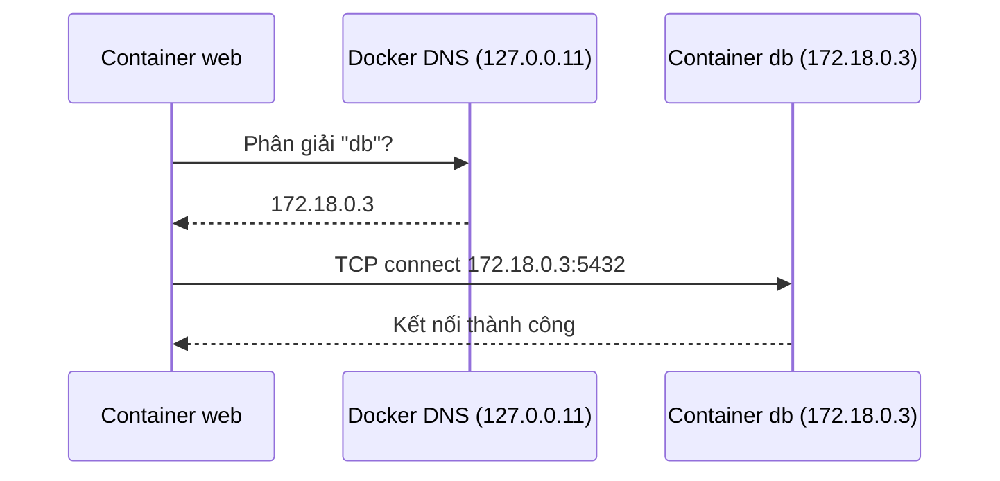

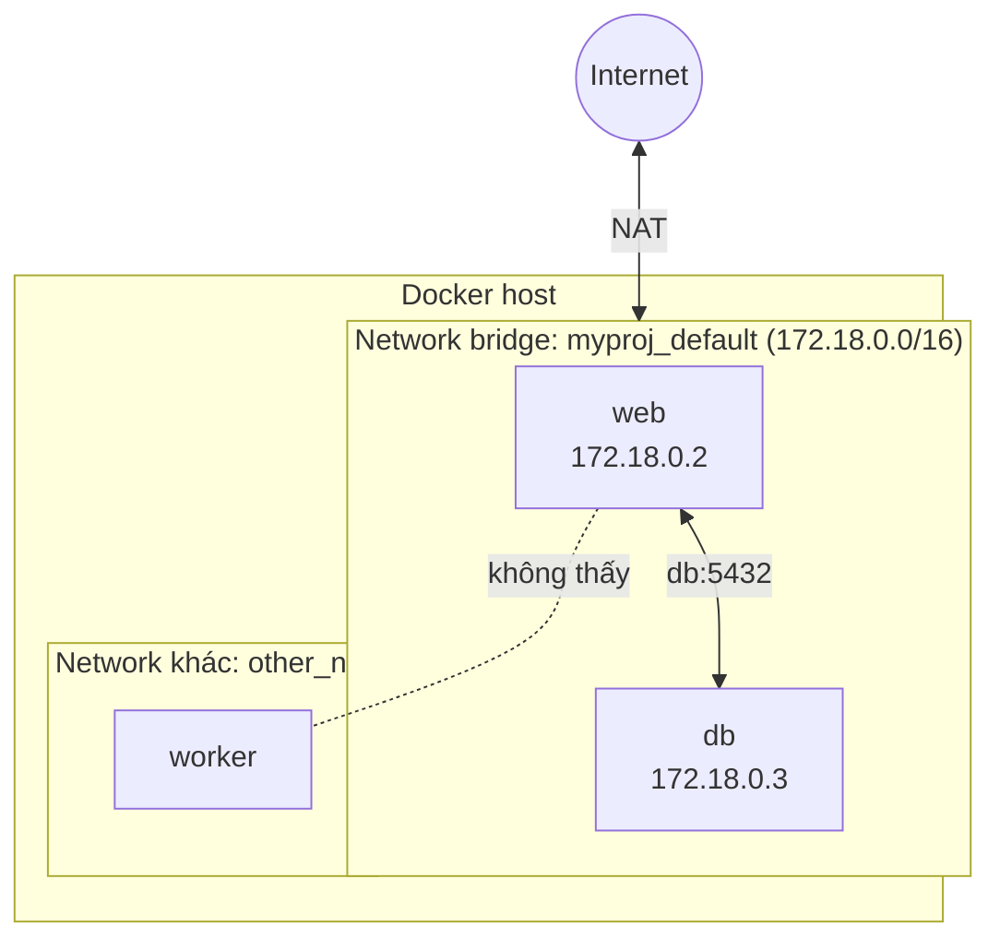

Hai lưu ý hay gặp lỗi:

1. **Trong container, `localhost` là chính container đó**, không phải host và không phải container khác. Cấu hình `DB_HOST=localhost` trong `web` sẽ trỏ về chính `web` → lỗi kết nối. Phải dùng `DB_HOST=db`.
2. **Gọi giữa các container dùng port *bên trong* container** (`db:5432`), không phải port đã publish ra host. Port publish (`-p`) chỉ dành cho truy cập **từ bên ngoài** (host/mạng LAN). Từ host muốn vào container thì dùng `localhost:<port-đã-publish>`; từ container muốn vào host dùng `host.docker.internal` (Docker Desktop).

---

## 6. Storage: volume và bind mount

### Vấn đề: dữ liệu trong container là tạm thời

Như đã nói ở [mục 1](#1-container-và-image), file ghi trong container nằm ở lớp ghi và **mất khi container bị xoá** (ngoài ra ghi qua union filesystem còn chậm). Docker cung cấp các cách gắn **thư mục nằm ngoài vòng đời container** vào bên trong container.

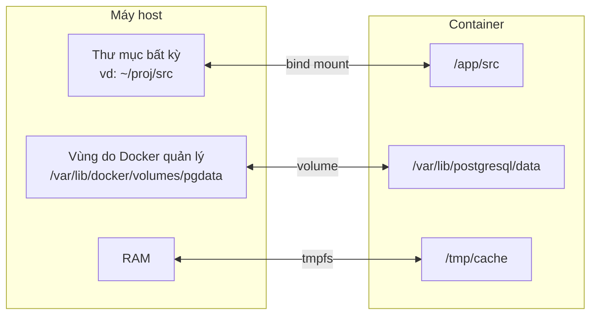

### So sánh volume và bind mount

| Tiêu chí | **Volume** (named volume) | **Bind mount** |
|---|---|---|
| Cú pháp | `-v pgdata:/data` (không bắt đầu bằng `/` hay `.`) | `-v /duong/dan/host:/data` hoặc `-v ./src:/app/src` |
| Nơi lưu | Vùng do **Docker quản lý** (`/var/lib/docker/volumes/...`) | **Đường dẫn bạn chỉ định** trên host |
| Ai quản lý | Docker (`docker volume ...`) | Bạn (là thư mục bình thường) |
| Phụ thuộc cấu trúc host | Không — portable giữa các máy | Có — đường dẫn phải tồn tại trên host |
| Khởi tạo nội dung | Nếu volume rỗng, Docker **copy dữ liệu có sẵn** ở đường dẫn đó trong image vào volume | **Che khuất** (shadow) nội dung có sẵn trong image tại đường dẫn đó |
| Hiệu năng | Tốt (nhất là trên Docker Desktop) | Trên Windows/macOS chậm hơn do qua lớp chia sẻ file |
| Backup / migrate | Dễ qua lệnh Docker | Là file thường, tự copy |
| Rủi ro | Dễ "mồ côi" nếu quên dọn | Container có thể sửa/xoá file thật trên host; vấn đề quyền (UID/GID) |

### Khi nào dùng loại nào?

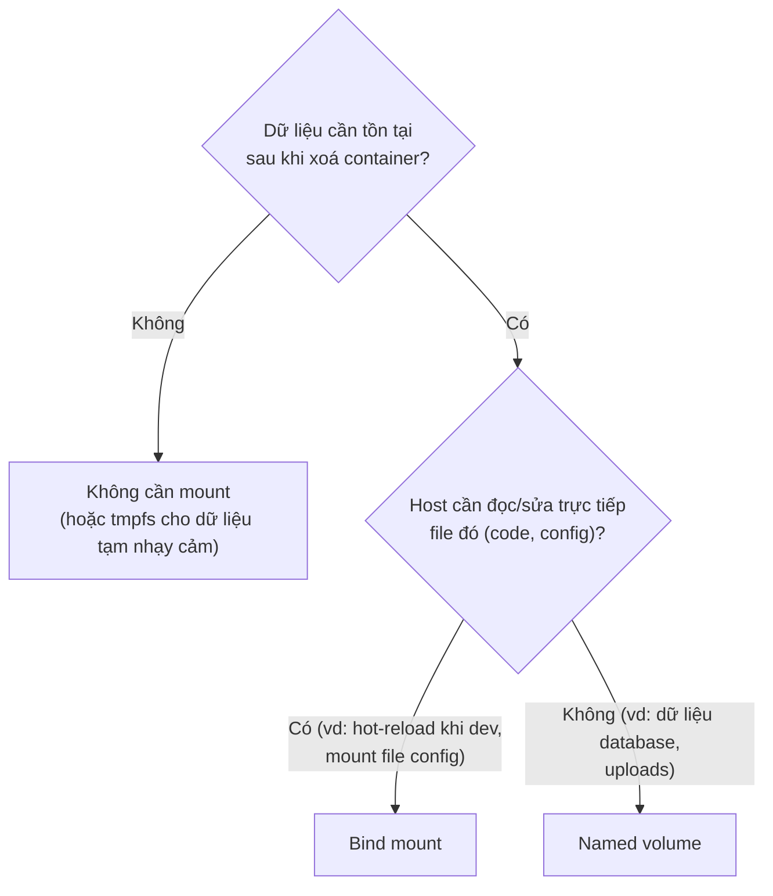

- **Volume → dữ liệu của ứng dụng cần bền**: database, file upload, cache cần giữ. Docker quản lý, an toàn, portable, hiệu năng tốt.
- **Bind mount → luồng phát triển**: mount source code để sửa trên host và container thấy ngay (hot reload); mount file cấu hình; chia sẻ output ra host.
- **tmpfs** (`--tmpfs /tmp`): lưu trong RAM, mất khi dừng — cho dữ liệu tạm/nhạy cảm.

### Hai ví dụ

```bash
# Named volume cho database: xoá container, dữ liệu vẫn còn
docker run -d --name db -v pgdata:/var/lib/postgresql/data -e POSTGRES_PASSWORD=secret postgres:16

# Bind mount cho dev: sửa file trong ./src, container thấy ngay
docker run -d --name web -v "$(pwd)/src":/app/src -p 3000:3000 node-app:dev
```

> Trong Compose: `./src:/app/src` (bind mount, có `./` hoặc `/`) và `pgdata:/var/lib/...` (named volume, phải khai báo ở khối `volumes:` cấp cao nhất).

---

## 7. Port mapping (`-p`) và `EXPOSE`

### Vì sao cần port mapping?

Container nằm trong network ảo riêng. Một tiến trình lắng nghe ở port 80 **bên trong** container thì từ bên ngoài (trình duyệt trên host) **không** truy cập được trực tiếp. Port mapping (publish) tạo một **quy tắc chuyển tiếp** (iptables/NAT) từ port của host vào port của container.

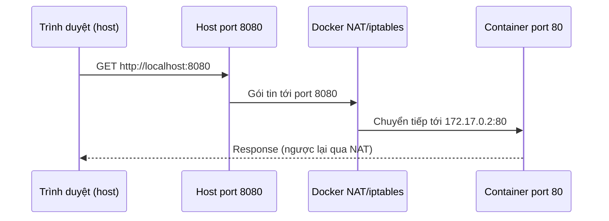

### `-p` vs `EXPOSE`

| | `EXPOSE 80` (trong Dockerfile) | `-p 8080:80` (khi `docker run`) |
|---|---|---|
| Tác dụng | **Tài liệu hoá**: "ứng dụng này dùng port 80" | **Thực sự mở** port ra host |
| Có truy cập được từ host? | ❌ Không | ✅ Có |
| Ảnh hưởng đến ứng dụng? | Không (không mở/đóng gì cả) | Tạo quy tắc chuyển tiếp |
| Công dụng phụ | Dùng bởi `-P` (publish tất cả port EXPOSE sang port ngẫu nhiên của host) | — |

Cú pháp `-p`:

| Dạng | Ý nghĩa |
|---|---|
| `-p 8080:80` | Host `8080` → container `80`, lắng nghe trên mọi interface (`0.0.0.0`) |
| `-p 127.0.0.1:8080:80` | Chỉ cho truy cập từ chính máy host (an toàn hơn cho DB, tool nội bộ) |
| `-p 80` | Container `80` → port **ngẫu nhiên** của host (xem bằng `docker port`) |
| `-p 8080:80/udp` | Chỉ định giao thức UDP |
| `-P` | Publish mọi port `EXPOSE` ra port ngẫu nhiên |

Lưu ý:

- Ứng dụng trong container phải lắng nghe trên **`0.0.0.0`**, không phải `127.0.0.1`. Nếu app chỉ bind `127.0.0.1` thì ngay cả khi có `-p` vẫn không truy cập được từ ngoài.
- Hai container có thể cùng dùng port 80 bên trong; chỉ port **host** mới phải khác nhau (`-p 8080:80`, `-p 8081:80`).
- Container gọi nhau trong cùng network **không cần** `-p` (xem [mục 5](#5-network)).
- Network `host`: bỏ qua `-p` hoàn toàn vì dùng chung port với host.

---

## 8. Biến môi trường và file `.env`

### Vì sao dùng biến môi trường?

Theo nguyên tắc *12-factor app*: **cùng một image** chạy ở dev/staging/prod, chỉ **cấu hình** (URL database, mật khẩu, chế độ debug...) thay đổi qua biến môi trường — không build lại image cho mỗi môi trường.

### Các cách truyền biến vào container

| Cách | Ví dụ | Ghi chú |
|---|---|---|
| `ENV` trong Dockerfile | `ENV NODE_ENV=production` | **Giá trị mặc định** nằm trong image |
| `-e` / `--env` | `docker run -e DB_HOST=db app` | Ghi đè `ENV`; `-e NAME` (không có `=`) lấy giá trị từ shell hiện tại |
| `--env-file` | `docker run --env-file .env app` | Đọc nhiều biến từ file, mỗi dòng `KEY=value` |
| Compose `environment:` | `environment: { DB_HOST: db }` | Khai báo trực tiếp trong YAML |
| Compose `env_file:` | `env_file: [.env.web]` | Nạp cả file vào container |
| `ARG` (chỉ lúc build) | `docker build --build-arg APP_VERSION=1.2 .` | **Không** có trong container lúc chạy |

### Hai vai trò khác nhau của `.env` trong Compose (hay bị nhầm)

| | File `.env` (tự động, cạnh `compose.yaml`) | `env_file:` |
|---|---|---|
| Dùng để | **Thay thế `${VAR}` bên trong file compose** (interpolation) — cấu hình bản thân file Compose | **Truyền biến vào container** |
| Vào container? | **Không tự động** | Có |

```
# .env (cạnh docker-compose.yml)
POSTGRES_VERSION=16
APP_PORT=8080
DB_PASSWORD=secret
```

```yaml
services:
  db:
    image: postgres:${POSTGRES_VERSION}        # interpolation lấy từ .env
    environment:
      POSTGRES_PASSWORD: ${DB_PASSWORD}        # muốn vào container phải ghi tường minh
  web:
    ports:
      - "${APP_PORT:-3000}:3000"               # ${VAR:-default}: dùng 3000 nếu chưa đặt
    env_file:
      - .env.web                               # nạp nguyên file này vào container web
```

### Thứ tự ưu tiên (cao → thấp) khi cùng một biến được đặt nhiều nơi

1. Lệnh `docker compose run -e VAR=...`
2. `environment:` trong compose file
3. `env_file:` trong compose file
4. `ENV` trong Dockerfile

Với *interpolation* `${VAR}` trong file compose: biến của **shell hiện tại** thắng file `.env`.

### Lưu ý bảo mật

- **Không commit** `.env` chứa secret: thêm vào `.gitignore` (và `.dockerignore` để không bị `COPY` vào image). Commit file mẫu `.env.example` thay thế.
- Biến `ENV`/`ARG` bị **ghi vào layer** của image → xem được bằng `docker history`/`docker inspect`. Secret thật nên truyền lúc chạy, hoặc dùng *Docker secrets*/BuildKit `--secret`.
- Chỉ sửa biến môi trường thì phải **tạo lại container** (`docker compose up -d` sẽ tự recreate nếu cấu hình đổi); `restart` thôi chưa chắc nạp lại.

---

## 9. Phụ lục: lỗi thường gặp

| Triệu chứng | Nguyên nhân thường gặp | Cách xử lý |
|---|---|---|
| Mở `localhost:8080` không được dù container đang chạy | Quên `-p`, hoặc app bind `127.0.0.1` thay vì `0.0.0.0` | Thêm `-p 8080:<port-app>`; cấu hình app lắng nghe `0.0.0.0` |
| `web` không kết nối được `db` qua `localhost` | `localhost` trong container là chính nó | Dùng tên service: `db:5432` |
| Mất dữ liệu DB sau khi xoá/tạo lại container | Không dùng volume | Mount named volume vào thư mục dữ liệu |
| Mỗi lần sửa 1 dòng code lại cài lại dependency | Thứ tự `COPY` làm hỏng cache | `COPY package*.json` + `RUN install` trước `COPY . .` |
| `docker stop` mất ~10 giây mới dừng | Dùng shell form nên app không nhận `SIGTERM` | Đổi sang exec form: `CMD ["node","server.js"]` |
| Compose: app khởi động lỗi vì DB chưa sẵn sàng | `depends_on` chỉ đợi container *start* | Thêm `healthcheck` + `condition: service_healthy`, hoặc cho app retry kết nối |
| Bind mount: ghi đè mất file có sẵn trong image | Bind mount che khuất thư mục trong image | Mount vào đường dẫn khác, hoặc dùng named volume |
| Đã sửa `.env` nhưng container vẫn giá trị cũ | Container chưa được tạo lại | `docker compose up -d --force-recreate` |
| Ổ đĩa đầy do Docker | Image/container/volume cũ tích tụ | Xem `docker system df`, dọn bằng `docker system prune` (xem [docker-commands.md](docker-commands.md#4-dọn-dẹp-và-hệ-thống)) |
